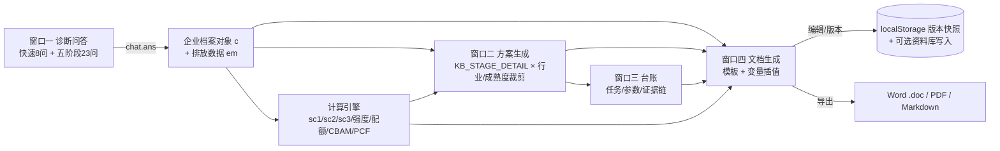

# 双碳咨询落地方案系统 · 升级改造说明书

> 交付对象：WorkBuddy（用于实操改代码）
> 目标文件：`C:\Users\888888\WorkBuddy\2026-10-13-10-12-32\shuangtan.html`（单文件页面，节点 `EZFVbjpvOiNLoOtayrUOT1`）
> 验证数据集：`C:\Users\888888\Doubao\chats\2026-10-13\new-chat-2\虚拟水泥企业双碳数据集.xlsx`（11 张表，配套生成脚本 `build_dataset.py` 含全部公式）
> 配套附件：`附件A_五阶段实施内容库_水泥行业.json`、`附件B_窗口一五阶段问答脚本.json`、`附件C_行业扩展包_2027同步版.md / .json`
> 核验基准日：2026-10-13

---

## 0. 怎么用这份文档

### 0.1 一句话目标

把现在这个「三窗口 + 五阶段只有框架」的页面，升级成「四窗口 + 五阶段有具体实施内容 + 能按企业实际数据生成可编辑、可下载的 Word/PDF 方案书」的通用工具，让**每一家不同行业、不同成熟度的企业**填完问答后都能拿到一份为自己定制的落地方案。

### 0.2 要改的三件事（对应需求原文）

| 需求原文 | 对应改造 | 本文档章节 |
|---|---|---|
| 「窗口二中五阶段模版的内容只有框架，我需要框架所对应的具体实施内容」 | 窗口二：五阶段由「阶段/交付物/验收标准」三列框架，扩成每阶段 9 个板块的完整实施内容库 | 第 4 章 + 附件A |
| 「在窗口一中可以增加五阶段对应的提问内容能够准确能够收集企业的信息」 | 窗口一：新增「五阶段情报采集」，23 问分组问答 + 自动推导 + 一致性校验 + 完整度评分 | 第 3 章 + 附件B |
| 「交付的形态是PDF或者word形式，用户可以通过第四窗口中进行打开修改直到用户满意为止，之后用户再下载修改后的版本」 | 新增窗口四：方案文档工作台（生成 → 打开 → 编辑 → 版本 → 导出 Word/PDF） | 第 7 章 |
| 「把这个网页变成每个企业能用上的灵活网页」 | 行业/省份/参数/问答联动裁剪 + 多企业切换 + 空值降级 | 第 5、8 章 |
| 「这几个板块缺少联动性」 | 立一条主链（采集 → 计算 → 方案 → 任务 → 成品），给出联动矩阵、事件总线、溯源跳转 | **第 9 章** |
| 「收集方面缺少排放因子、范围一/二/三数据的收集」 | 新增 L2 排放源级采集：范围 1/2/3 逐源一行（活动数据+因子+来源+质量），因子三件套 + 两级因子库 | **3.9 节 + 5.2 节** |
| 「窗口二只有实施步骤，我需要最终结果定义（能交付给环保部门的内容）」 | 每阶段新增「对外成果物」区块 + 六类成品的字段级定义（报告/质控计划/台账/核查包/履约/CBAM） | **4.6 节 + 第 10 章** |
| 「内容抓取的范围和深度怎么定」 | 三层筛子定范围、L0–L3 定深度、交付物字段逐条倒推档位、三条硬线；完整度算法改为「交付物字段覆盖率」 | **第 13 章** |
| 「按已知和 2027 需要同步的行业全方面整理（组织边界、范围、政策、途径、方案）」 | 9 个行业扩展包：已纳管 4（电力热力/钢铁/水泥建材/铝）+ 扩容候选 3（石化化工/造纸/民航）+ CBAM 驱动 2（化肥/氢），每个行业五维度齐全 | **附件C** |

### 0.3 实施顺序（建议按批次做，每批可独立验收）

| 批次 | 内容 | 优先级 | 依赖 |
|---|---|---|---|
| 第 1 批 | 窗口二五阶段完整实施内容（含附件A 内容库落地） | P0 | 无 |
| 第 2 批 | 窗口一五阶段问答 + 完整度评分 + 一致性校验 | P0 | 第 1 批的字段定义 |
| 第 3 批 | 计算引擎（排放/强度/配额/CBAM/PCF）+ 窗口三参数面板 | P1 | 数据集公式 |
| 第 4 批 | 窗口四文档工作台 + Word/PDF 导出 | P0（用户最关心的交付形态） | 第 1、3 批产出内容 |
| 第 5 批 | 窗口一 L2 分范围数据与排放因子采集 + 窗口三参数与因子面板 | P0 | 第 3 批计算引擎 |
| 第 6 批 | 联动矩阵落地 + 六类对外成果物章节（面向环保部门） | P0 | 第 1、4、5 批 |
| 第 7 批 | 按第 13 章落地：档位判定 + 覆盖率算法 + 硬线拦截 + 政策库升级到可引用级 | P1 | 第 5 批（L2 采集） |
| 第 8 批 | 合入附件C 行业扩展包：9 个行业的组织边界、范围清单、政策卡、途径库、方案模板 | P0（客户覆盖面） | 第 1、5、7 批 |

> 提示：第 4 批虽然依赖前几批的内容，但**导出通道可以先做**（用现有三窗口已有数据就能生成文档），不必等全部内容库补齐。

---

## 1. 现状盘点（已逐行核对源码）

### 1.0 版本说明（重要：行号已过期，按变量名检索）

本页第 1.1–1.4 节的行号基于**改造前**的 1543 行版本。截至 2026-10-13 12:49，页面已增长到 **3113 行**，第 1、2 批已落地：

| 已实现 | 位置锚点（按变量/函数名检索，别按旧行号找） |
|---|---|
| 五阶段实施内容库 | `KB_STAGE_DETAIL`（约 958 行起，每阶段 14 板块） |
| 行业差异层 | `KB_STAGE_PATCH`（约 1310 行）+ `mergeStageDetail()`（约 1644 行）、`hasStagePatch()` |
| 参数与因子默认值 | `PARAMS`（约 1357 行） |
| 五阶段手风琴渲染 | `renderStageAccordion()`（约 2211 行） |
| 窗口一情报采集器 | `renderCollector()`、`renderCurrentQuestion()`（约 1814 / 1886 行）、`chat2` 会话状态 |
| 五阶段问答数据 | `QUESTIONS_STAGE`、`MODES`、`QUESTIONS_CORE`（约 1389–1393 行） |
| 质量门与缺口清单 | `runQualityGates()`（约 1521 行）、`buildGapList()`（约 1594 行） |
| 完整度评分 | `completeness()`（约 1486 行）、`COMPLETENESS_TIERS` |

**仍待做**：第 3 批计算引擎与参数面板、第 4 批窗口四（页面仍是三窗口，无 `docBody`）、第 5 批 L2 分范围数据与排放因子采集、第 6 批联动矩阵与六类对外成果物章节。

### 1.1 页面骨架

| 区块 | 位置（`shuangtan.html` 行号） | 现状 |
|---|---|---|
| 顶部工具条 | 241–260 | 同步状态、导出备份、导入恢复、清空示例 |
| 「今天要处理」 | 262–270 | 逾期/今日到期任务，可一键完成 |
| 三窗口栅格 | 272–363 | `grid-template-columns: 1.05fr 1.25fr 0.9fr`（87 行 CSS） |
| 窗口一 · 企业诊断对话 | 275–294 | 7 问问答，进度条 7 段，chips 选择 + 自由输入 |
| 窗口二 · 行业政策落地方案 | 297–311 | 空态占位 + `renderPlan()` 渲染 7 节内容 |
| 窗口三 · 落地台账 | 314–361 | 统计/客户列表/任务表单/任务明细 |
| 页脚口径声明 | 365–368 | 核算依据 + 核验基准日 |
| **窗口四** | — | **不存在，需新增** |

### 1.2 现有 JS 结构（三段 script，见 373 / 670 / 859 / 1267 行）

| 层 | 关键变量 / 函数 | 说明 |
|---|---|---|
| 数据层 | `DATABASE_ID='ouzjlp6kHJXD2w89gtwjIk'`（客户档案，13 字段）、`DB_TASK_ID='39INs1CYHtjSF6gv0Bl5Bl'`（任务台账，11 字段） | 云端资料库 + localStorage 双向同步 |
| 数据层 | `state{customers,tasks,cur,sync,demo}`、`saveCustomer/saveTask/localSave*` | 以「客户名」为主键合并，注意 `mergeByKey` 对任务按 `name` 合并 |
| 知识库 | `KB_INDUSTRY`（13 行业，677–762 行） | 每行业含 `scope/market/points/hot` 四要素 |
| 知识库 | `KB_PROVINCE`（27 省 + 一条 `江苏市` 脏数据，764–790 行） | `pts/note` 两要素；`江苏市` 在 789 行需清理 |
| 知识库 | `KB_PRODUCT`（8 产品线，792–801 行） | 每产品线一段话定义 |
| 知识库 | **`KB_5STAGE`（803–814 行）** | **这就是"只有框架"的五阶段**：每阶段只有 `deliver`（交付物）、`accept`（验收标准）、`tasks`（3–5 条任务名+部门+优先级+相对天数） |
| 计算层 | `judgeStage()` 816–830、`matchProducts()` 831–848、`roiText()` 849–857 | 成熟度权重 +1/+2/+2/+3，阈值 5/4/2；`roiText` 里碳价 **硬编码 60 元/t** |
| 渲染层 | `esc()`、`sanitizeHtml()`、`setHTML()`、`renderToday/renderChat/renderAsk/renderPlan/renderClients/renderStats/renderTasks`、`refreshAll()` | 统一入口，`innerHTML` 必须走 `setHTML` |
| 事件层 | `onChipClick/onSend/onListClick/genTasks/addClient/saveTaskFromForm` | `genTasks()` 1381–1413：按 `KB_5STAGE.tasks` 生成任务，`deliver` 直接取阶段级交付物 |

### 1.3 现状缺口清单（逐条对应改造点）

| 编号 | 缺口 | 证据（源码位置） | 改造 |
|---|---|---|---|
| G1 | 五阶段无具体实施内容：只有阶段名、交付物名、验收一句话、3–5 条任务名 | `KB_5STAGE` 803–814 | 第 4 章 |
| G2 | 五阶段任务里 `deliver` 复用阶段级交付物，11 个任务共用 5 个交付物名 | `genTasks()` 1394 | 第 4.5 |
| G3 | 窗口一只有 7 问，全部是「售前诊断」信息，未采集企业级排放/能源/产线数据 | `QUESTIONS` 965–973 | 第 3 章 |
| G4 | 采集到的数据无处存放：客户档案 13 字段里没有任何产能/能耗/排放字段 | `custToRec()` 406–422 | 第 5.1 |
| G5 | 没有计算引擎：数据集里的排放/强度/配额/CBAM 公式在页面上完全缺失，只有碳价×减排量的粗略 ROI | `roiText()` 849；`renderPlan()` 六节 | 第 6 章 |
| G6 | 没有文档交付通道：不能生成方案书、不能编辑、不能导出 Word/PDF | 全页无相关代码 | 第 7 章 |
| G7 | 参数不可配：碳价 60、回收期口径、行业基准值（如水泥 0.88 BP）硬编码在函数里 | `roiText()` 854、`matchProducts()` | 第 5.2、6.2 |
| G8 | 脏数据与口径问题：`KB_PROVINCE['江苏市']` 无用条目；数据集里 2 处单位/口径疑点 | 789 行；见 6.4 | 第 6.4 |

### 1.4 需求里「窗口四」的口径确认

现有页面**只有三个窗口，没有窗口四**。需求里说的「第四窗口」= 本次要新增的 **方案文档工作台**（生成/打开/编辑/导出）。窗口编号保持现有不变（窗口一=诊断对话、窗口二=落地方案、窗口三=落地台账、窗口四=文档工作台），避免用户认知错位。

---

## 2. 目标形态：四窗口 + 数据流

### 2.1 布局线框（保持单文件、纯 CSS 即改）

```
┌──────────────────────────── 顶部工具条 ────────────────────────────┐
│ 状态·同步   导出备份  导入恢复  清空示例        [新增：导出方案书]    │
├───────────────────────── 今天要处理 ──────────────────────────────┤
├───────────────┬───────────────────────┬───────────────────────────┤
│ 窗口一         │ 窗口二                │ 窗口三                     │
│ 企业诊断对话   │ 五阶段落地方案         │ 落地台账                   │
│ · 快速8问      │ · 诊断结论             │ · 客户档案                 │
│ · 五阶段23问   │ · 产品线组合           │ · 任务增改                 │
│ · 完整度环     │ · 行业核算要点         │ · 参数与因子（新）          │
│ · 资料缺口清单 │ · 属地政策             │ · 数据与证据链（新）        │
│               │ · ★五阶段实施内容（改）│ · 阶段验收进度              │
├───────────────┴───────────────────────┴───────────────────────────┤
│ 窗口四 · 方案文档工作台（新增，grid-column:1/-1 整行）              │
│ [生成/重建] [插入五阶段章节] [保存版本] [导出Word] [打印PDF] [导出MD] │
│ ┌─目录树───────┬─正文编辑区（contenteditable，变量已替换）────────┐ │
│ │ 1 项目概述    │  第一章 …                                          │ │
│ │ 2 企业现状    │  {{企业名称}} 位于 {{属地}}，行业 {{行业}}…        │ │
│ │ 3 核算边界    │  ⚠ 待补充：熟料年产量（点此回到窗口一第 10 问）    │ │
│ │ 4 五阶段实施  │                                                    │ │
│ │ 5 技经测算    │                                                    │ │
│ └───────────────┴────────────────────────────────────────────────────┘ │
└───────────────────────────────────────────────────────────────────┘
```

CSS 改动要点（最小侵入）：

```css
/* 87 行 .windows 保持三列不变 */
@media (max-width:1180px){ .win:nth-child(3){grid-column:1/-1} }  /* 现有 214 行逻辑保持 */
.win.doc{grid-column:1/-1;margin-top:14px}          /* 窗口四整行 */
.doc-wrap{display:grid;grid-template-columns:220px minmax(0,1fr);gap:12px}
.doc-toc{max-height:520px;overflow:auto;border:1px solid var(--line2);border-radius:9px}
.doc-body{min-height:520px;max-height:620px;overflow:auto;border:1px solid var(--line2);
          border-radius:9px;padding:14px 18px;background:#fff;line-height:1.85}
.doc-body h2{font-size:16px;margin:14px 0 8px;padding-bottom:5px;border-bottom:1px solid var(--line2)}
.doc-body table{width:100%;border-collapse:collapse;font-size:12.5px;margin:8px 0}
.missing{background:var(--warn-l);border:1px dashed #f6d5b8;border-radius:6px;padding:1px 6px;
         color:#8a3d0c;font-size:12.5px;cursor:pointer}   /* 「待补充」占位 */
@media (max-width:768px){ .doc-wrap{grid-template-columns:1fr} }
```

### 2.2 数据流（四窗口单向循环，不新增环）



**硬约束**：数据层 → 计算层 → 渲染层仍然单向；所有 DOM 写入仍走 `setHTML()`；`refreshAll()` 仍是唯一刷新入口。

---

## 3. 窗口一改造：五阶段情报采集器

### 3.1 设计原则（为什么不是「再加 20 个问题」）

1. **不破坏现有 7 问**：现有 7 问是售前诊断的核心，保留原 key（`name/industry/province/scale/force/pains/chain`），老数据、老逻辑（`judgeStage`/`matchProducts`）全部兼容。
2. **按阶段分组、可跳可补**：23 个新问题按五阶段分成 5 组，逐组推进；每组可「跳过本组」，跳过即在该字段写 `待补充` 并进入「资料缺口清单」，**绝不编造数值**。
3. **两种模式**：`快速诊断`（现有 7 问，1 分钟）+ `完整诊断`（7 问 + 23 问，约 10 分钟）。随时切换，答案不丢。
4. **问答即数据**：每个问题绑定唯一字段 `key`，直接落到企业档案（`c.*`）与排放数据块（`c.em.*`），供窗口二/四/计算引擎消费。
5. **答完即校验**：每完成一组跑一次一致性校验（见 3.5），发现矛盾立刻追问，而不是等出报告才发现。
6. **答完即评分**：右上角显示「信息完整度 %」，并列出缺什么、缺了会影响哪一章输出。

### 3.2 问题分组总览

| 组 | 阶段 | 题号 | 题数 | 目的 | 对应 Excel 表 |
|---|---|---|---|---|---|
| 0 | 通用（现有） | Q1–Q7 | 7 | 企业身份、成熟度、痛点、预算决策链 | 00 |
| 1 | 售前诊断 | Q8–Q11 | 4 | 企业物理边界与合规身份，决定方案范围 | 00、09 |
| 2 | 项目启动 | Q12–Q14 | 3 | 组织边界、核算年度、既有体系与数据可得性 | 00、09 |
| 3 | 现状调研 | Q15–Q20 | 6 | 产线/产量、能源结构、台账与计量、运输、其他排放、数据owner | 01、02、03、10 |
| 4 | 方案设计 | Q21–Q24 | 4 | 目标、已定技改、投资约束、政策诉求 | 05、06、07、09 |
| 5 | 交付落地 | Q25–Q27 | 3 | 交付形态、披露要求、核查对接与内部碳价 | 08、09 |

> 合计 27 问；「完整诊断」= Q1–Q27，「快速诊断」= Q1–Q7。

### 3.3 五组问题全稿

字段命名约定：企业档案用短名（`c.industry`），排放与物理数据统一挂到 `c.em.*`（em = emission meta），便于 6 章计算引擎按 `c.em.xxx` 取数。所有 `key` 必须与附件B 完全一致。

#### 组 1 · 售前诊断（Q8–Q11）

| 题号 | 问题 | 交互 | 字段 key | 校验/追问 |
|---|---|---|---|---|
| Q8 | 贵司统一社会信用代码或行业代码是？（用于核对行业分类与纳管范围） | 文本输入 | `creditCode` | 18 位校验；留「暂不提供」 |
| Q9 | 主营产品与产线情况？（例：P·O42.5 水泥 220 万吨/年，1 条 5000t/d 熟料线） | 文本 + 数量 | `productsLine` | 追问产线条数与单线规模 |
| Q10 | 是否属于全国碳市场重点排放单位？是否出口欧盟（含经第三国转口）？ | 双 chips | `isETS` / `isCBAM` | 二者任一为「是」→ 触发履约/CBAM 章节 |
| Q11 | 是否还有其他厂区/子公司需纳入本次范围？ | chips（1 个 / 2–5 个 / 5 个以上 / 暂不确定） | `siteCount` | >1 时追问各厂区是否独立核算 |

#### 组 2 · 项目启动（Q12–Q14）

| 题号 | 问题 | 交互 | 字段 key | 校验/追问 |
|---|---|---|---|---|
| Q12 | 本次核算的法人/组织边界与核算年度？ | chips（单一法人单一厂区 / 多厂区合并 / 集团口径）+ 年份 chips（2023/2024/2025） | `boundary` / `baseYear` | 与 Q11 对照，冲突则提示 |
| Q13 | 是否已做过：碳盘查 / 第三方核查 / ISO 14064 / ESG 披露？ | 多选 chips | `existingSys` | 已有 → 追问最近一次年份与出具方 |
| Q14 | 数据能否提供？请逐项勾选：月度能耗台账 / 产量与质量台账 / 化验室煤质报告 / 电费单与用电记录 / 计量器具台账 / 运输台账 | 多选 chips（每项标注「有/部分/无」） | `dataAvail` | 缺项 → 进入资料缺口清单并给补齐建议 |

#### 组 3 · 现状调研（Q15–Q20，核心数据组）

| 题号 | 问题 | 交互 | 字段 key | 对应 Excel |
|---|---|---|---|---|
| Q15 | 主要产品产量：熟料 ___ 万吨/年、水泥 ___ 万吨/年、设计产能 ___ | 数字 ×3 | `em.clinkerOut` / `em.cementOut` / `em.capacity` | 00 B13–B16 |
| Q16 | 能源结构：原煤 ___ 万吨、替代燃料 ___ 万吨、柴油 ___ 吨、外购电 ___ 万kWh、余热自发电 ___ 万kWh、绿电 ___ 万kWh | 数字 ×6 | `em.coal` / `em.af` / `em.diesel` / `em.gridBuy` / `em.whr` / `em.greenPower` | 00 B17–B21、01、02 |
| Q17 | 原料与工艺：石灰石 ___ 万吨、替代原料（电石渣/钢渣等）___ 万吨 | 数字 ×2 | `em.limestone` / `em.altRaw` | 00 B19、01 行 8 |
| Q18 | 计量与数据基础：电子皮带秤/磅秤是否检定有效？中控 DCS 是否可取煤量与电耗？煤质化验频次？ | chips 三问 | `em.metering` / `em.dcs` / `em.labFreq` | 01/02 备注列 |
| Q19 | 运输与流向：原料运距 ___ km、产品主要销往 ___、是否有出口 | 数字 + 文本 + chips | `em.haulIn` / `em.marketDir` | 03 类别 1/4/9 |
| Q20 | 其他范围 3 数据（废弃物/差旅/通勤/包装材料）可得性？ | chips（全有 / 部分 / 无） | `em.otherS3` | 03 类别 5–7 |

可选追问（Q18 之后按需触发，不占正式题号）：数据责任人是谁？（`em.dataOwner`，写入 RACI）

#### 组 4 · 方案设计（Q21–Q24）

| 题号 | 问题 | 交互 | 字段 key | 校验/追问 |
|---|---|---|---|---|
| Q21 | 是否已有双碳目标？如「2030 年吨熟料碳强度较 2024 下降 10%」 | chips（无 / 有定性目标 / 有量化目标）+ 文本 | `hasTarget` / `targetText` | 有量化 → 与计算引擎算出的现状强度对比并提示可达性 |
| Q22 | 已确定或已立项的技改/替代计划？（原料替代 / 燃料替代 / 余热发电扩容 / 粉磨系统节能 / 光伏绿电 / CCUS 预研 / 暂无） | 多选 chips | `techPlan` | 勾选项在窗口二路径图里标记为「已有基础」，避免重复建议 |
| Q23 | 投资与回报约束？ | chips（回收期 ≤2 年 / ≤3 年 / ≤5 年 / 仅合规必需投入 / 待评估） | `investRule` | 决定窗口二技经测算的排序与取舍 |
| Q24 | 政策诉求？（节能技改专项资金 / 绿色工厂 / 超低排放 / CCER 开发 / 碳足迹标识 / 暂不需要） | 多选 chips | `policyAsk` | 勾选项触发窗口二第 4 节补贴申报路径 |

#### 组 5 · 交付落地（Q25–Q27）

| 题号 | 问题 | 交互 | 字段 key | 校验/追问 |
|---|---|---|---|---|
| Q25 | 需要什么形态的交付物？（诊断报告 / 核算底稿与台账模板 / LCA 模型 / 碳资产管理制度 / 培训 / 核查对接）+ 语言（中文 / 中英双语） | 多选 chips + 语言 chips | `deliverForm` / `docLang` | 直接决定窗口四生成哪些章节 |
| Q26 | 是否有对外披露或客户问卷需求？（ESG/TCFD / CDP / CBAM 申报 / 主机厂或客户碳问卷 / 无） | 多选 chips | `disclose` | 勾选 CBAM → 强制生成 CBAM 章节并校验出口量 |
| Q27 | 是否需要预留第三方核查接口？内部碳价与考核挂钩？ | 双 chips | `needVerify` / `internalCarbonPrice` | 内部碳价为空时，窗口二技经测算沿用外部碳价并标注 |

### 3.4 与 Excel 数据集的字段映射（11 张表全覆盖）

| Excel 表 | 页面字段前缀 | 消费方 | 缺数据时的降级 |
|---|---|---|---|
| `00_企业基本信息` | `c.*` + `c.em.*` | 窗口一/二/三/四、计算引擎 | 报告写「待补充」并进缺口清单 |
| `01_范围1_直接排放` | `em.scope1.*` | 计算引擎、窗口四第三章 | 用行业缺省因子算出「估算值」并标灰 |
| `02_范围2_间接排放` | `em.scope2.*` | 同上 | 同上 |
| `03_范围3_其他间接排放` | `em.scope3[15]` | 计算引擎、ESG 章节 | 未采集类别显示「未纳入本次核算」 |
| `04_排放汇总` | 计算结果 `em.result.*` | 窗口二/四 | 不缓存，实时算 |
| `05_产品碳足迹_LCA` | `em.pcf.*` | 窗口四第四章、绿色产品章节 | 无产品级数据则只出组织级 |
| `06_碳市场履约` | `em.ets.*`（BP、年份、抵销上限） | 履约章节、技经测算 | 非纳管企业整章隐藏 |
| `07_CBAM` | `em.cbam.*` | CBAM 章节 | 不出口则整章隐藏 |
| `08_ESG_TCFD_CDP` | `em.esg.*` | 披露章节 | 无需求则隐藏 |
| `09_政策清单` | `KB_PROVINCE` + `em.policy[]` | 窗口二第 4 节 | 属地未填 → 用国家层面政策并提示 |
| `10_排放因子库` | `PARAMS`（可编辑参数表） | 计算引擎 | 内置默认值，标注来源与年份 |

### 3.5 一致性校验（质量门，答完即跑）

在窗口一每答完一组、以及生成方案前各跑一次，不通过则弹「追问卡」而不是直接出结论。

| 编号 | 规则 | 触发后的追问话术 | 依据 |
|---|---|---|---|
| V1 | 熟料产量 ≤ 设计产能，水泥产量 ≥ 熟料产量 | 「水泥产量低于熟料产量，是否外销熟料？」 | 00 表逻辑 |
| V2 | 石灰石消耗 / 熟料产量 落在 1.1–1.4 t/t 区间 | 「石灰石单耗偏离常规区间，请核对是否含矿山剥离量」 | 行业经验值 |
| V3 | 年运转天数 = 熟料产量 ÷(产能÷365)，应与错峰生产安排一致 | 「按产能折算运转天数异常，是否有错峰/停机？」 | 水泥行业 |
| V4 | 外购电 + 余热自发电 + 绿电 ≈ 综合电耗 × 产量（±10%） | 「电量与产量推算的综合电耗偏差较大，请核对口径」 | 02 表 |
| V5 | 余热自发电量单位：**万kWh 与 MWh 必须换算（1 万kWh = 10 MWh）** | 「余热自发电 4200 万kWh 是否按 42,000 MWh 抵扣？」 | 见 6.4 缺陷① |
| V6 | 替代燃料占比 = 替代燃料热值 ÷ 总燃料热值 | 「替代燃料占比与热量口径不一致，请确认按热量还是重量」 | 05 表 3.2% |
| V7 | 出口量 > 0 才生成 CBAM 章节；CBAM 抵扣口径需与国内碳价一致 | 「CBAM 抵扣比例按 5% 还是按已付碳价折算？」 | 见 6.4 缺陷② |
| V8 | 若 `isETS=是` 但填了「无月度台账」，标记为高风险并置顶缺口清单 | 「纳管企业无月度台账，核查风险高，建议 30 天内补齐」 | 履约刚性 |

### 3.6 信息完整度与资料缺口清单

- **完整度算法**：`完整度 = Σ(权重×已填) ÷ Σ权重`，权重建议：组 0（身份/成熟度）20%、组 3（排放数据）40%、组 1/2（边界与启动）20%、组 4（方案约束）10%、组 5（交付要求）10%。
- **三档提示**：≥80% →「可出完整方案书」；50–79% →「可出方案框架 + 数据待补清单」；<50% →「仅出诊断结论与数据需求清单」，窗口四不生成完整章节（避免用缺省值堆出一份看着完整其实不能用的报告）。
- **资料缺口清单**（新增区块，放窗口一的问答区下方）：每条 = 缺什么 / 影响哪一章 / 建议向谁要 / 建议补齐时限；点条目可跳回对应问题。

### 3.7 交互细则

| 场景 | 规则 |
|---|---|
| 跳过整组 | 组标题右侧「跳过本组」→ 该组字段写 `待补充`，记入缺口清单，进度条该段标灰 |
| 单题跳过 | 输入框右侧「暂不提供」按钮，行为同上（单字段） |
| 回退改答 | 已答问题在对话流上以「✎ 修改」小按钮回填，改答后自动重跑 V1–V8 与完整度 |
| 数字输入 | 统一用 `type="text" inputmode="decimal"`（避开 number 的滚轮误改），失焦时校验范围并给单位提示 |
| 自由输入不识别 | 沿用现有 `onSend()` 关键词兜底，但**新增**：识别失败时给「我没听懂，你是想问哪种？」+ chips 兜底，不允许静默把整句当成数值 |
| 进度条 | 现有 7 段（284 行）改为「模式相关」：快速模式 7 段，完整模式 27 段（或 5 组大段 + 组内小点） |
| 落库时机 | 每答完一组即 `saveCustomer(c)`，避免中途关闭丢数据；沿用 `persistChat()` 草稿恢复 |

### 3.8 落库与 schema（关键风险，必须先处理）

1. **客户档案表 13 字段不够用**：`em.*`（排放与物理数据）字段较多，有两种可行方案：
   - **方案 A（推荐，改动小）**：把 `em` 对象序列化成 JSON 字符串，存进客户档案表的**一个多行文本字段**（如新增字段「排放与参数」）。优点：不动结构；缺点：云端不可按字段筛选。
   - **方案 B（结构化，改动大）**：在客户档案表新增 30+ 字段（熟料产量、原煤、外购电……）。优点：可筛选、可统计；缺点：需要改资料库 schema，且 `custToRec()/recToCust()` 要同步改两处。
   - **建议**：先做方案 A 交付，把结构化列为 P2。
2. **新增 select 选项必须同步云端 schema**：任务台账的「所属阶段/责任部门/优先级/状态」是 select 字段，`fillSelects()` 明确「运行时从 schema 拉取，不硬编码」（1236–1265 行）。如果要在窗口二新增部门或阶段**取值**，必须先在资料库 schema 里加好选项，否则 `addRecord` 会失败。
3. **DSDK002 硬编码要求**（来自 workbuddy 记忆）：所有 SDK 调用点必须出现字面量 `databaseId: 'xxx'` 或 `databaseId: DATABASE_ID` 且页面存在 `var DATABASE_ID = 'xxx'`；写成 `databaseId: DB_CUST` 不通过 lint。新增表（如参数表、文档版本表）同理。

### 3.9 分范围数据与排放因子采集（补齐范围 1/2/3）

**为什么必须补这一层**：现在 Q15–Q20 只采到「企业总量级」（总煤量、总电量、石灰石总量），而窗口二能出多精细的方案，完全取决于数据的粒度。只有总量级数据时，技经测算只能拿行业缺省值算估算值——环保部门拿去没法用，核查也过不了。所以采集要分三层：

| 层 | 内容 | 落库 | 谁在用 |
|---|---|---|---|
| L1 总量级 | 现有 Q15–Q20（产量、能源结构、原料、计量、运输、其他） | `em.*` | 快速测算、给客户看规模量级 |
| L2 排放源级 | 按范围 1/2/3 逐排放源一行：活动数据 + 单位 + 因子 + 因子来源 + 数据质量 | `em.scope1[]` / `em.scope2[]` / `em.scope3[]` | 窗口二技经测算、窗口四核算结果章节、对外报送材料 |
| L3 证据级 | 凭证编号、计量器具、化验报告、能源结算单 | `em.evidence[]` | 核查配合材料包、证据链索引 |

#### 3.9.1 范围 1 采集表（直接排放）

| 排放源 | 活动数据 | 单位 | 排放因子 | 因子来源与版本 | 数据质量 |
|---|---|---|---|---|---|
| 熟料煅烧—原煤 | 原煤消耗量 | t | NCV 21 GJ/t、单位热值含碳量 26.18 tC/TJ、氧化率 0.99 | 核算指南缺省值 / 企业化验室实测 | 实测 或 缺省 |
| 熟料煅烧—替代燃料 | 替代燃料消耗量 | t | 含碳率、非生物质碳比例 | 企业实测优先，缺失用缺省值并标注 | 实测 或 缺省 |
| 辅助燃油 | 柴油消耗量 | t | NCV 42.65 GJ/t、EF 74100 kgCO₂/TJ | 核算指南 | 缺省 |
| 工业生产过程 | 熟料产量 | t | 过程排放因子 0.535 tCO₂/t熟料 | 核算指南 2024 | 缺省 |
| 替代原料扣减 | 非碳酸盐原料用量 | t | 按化学成分分析折算 | **必须有化验报告**，否则不允许扣减 | 实测 |
| 逸散排放 | 是否涉及 SF₆/HFC | — | GWP（IPCC AR5） | 水泥行业一般为「不适用」 | — |

#### 3.9.2 范围 2 采集表（外购能源间接排放）

| 排放源 | 活动数据 | 单位 | 排放因子 | 因子来源 | 数据质量 |
|---|---|---|---|---|---|
| 外购电力 | 外购电量 | MWh | 区域电网因子（西南区域示例 0.45 tCO₂/MWh） | 区域电网年度排放因子 | 区域平均 |
| 余热自发自用抵扣 | 抵扣电量 | MWh | 同电网因子 | 余热发电记录 | 实测 |
| 绿电（市场法） | 绿电电量 | MWh | 0（须有绿证注销凭证） | 绿电交易/绿证核发凭证 | 实测 |
| 外购热力 / 蒸汽 | 热量 | GJ / t | 热力因子（示例 0.11 tCO₂/GJ） | 核算指南 | 缺省 |

#### 3.9.3 范围 3 采集表（其他间接排放，15 类逐类判断）

采用「一行一类」结构，每行五个字段：`类别 / 活动数据 / 单位 / 因子 / 判断`。判断只能是「纳入 / 未纳入 / 不适用」三选一，且**必须写原因**（如「不适用：水泥使用阶段无燃烧排放」）。默认值直接沿用数据集 `03_范围3` 表（类别 1、2、3、4、5、6、7、9 有值，其余为 0 或不适用）。

#### 3.9.4 排放因子采集规则（决定报告能不能过核查）

1. **每个因子必须三件套**：取值 + 来源（文件号/版本/年份）+ 数据质量等级（实测 / 供应商实测 / 区域平均 / 国家缺省）。**来源为空时禁止保存**，弹提示「因子必须标来源，核查第一问就是这个」。
2. **优先级**：企业实测 > 供应商实测 > 区域平均 > 国家缺省值。用缺省值时报告里必须写明「本次采用缺省值」及未实测原因。
3. **两级因子库**：`PARAMS`（页面内置全局默认，见附件A）+ `em.ef`（本项目覆盖值，随客户档案落库）。窗口二/四一律读「覆盖值优先、其次默认值」，并同时显示来源。
4. **因子变更即触发重算**：任何因子改动 → 重算范围 1/2/3 与全部强度/配额/CBAM/PCF → 写入 `changeLog`（时间、旧值、新值、依据、确认人）→ 窗口四顶部提示「参数已变更，报告需重新生成」→ 报告附录 B 自动更新。
5. **不允许静默替换**：不得把缺省值写成实测值，不得跨年度混用因子版本。

#### 3.9.5 交互设计

| 项 | 要求 |
|---|---|
| 入口一 | 窗口一第三组之后新增「范围数据（L2）」折叠步骤卡，逐范围展开填表，每行可增删 |
| 入口二 | 窗口三「数据与参数」面板做批量维护：粘贴导入（TSV）、一键填充缺省值、因子覆盖 |
| 实时计算 | 每行填完即时显示该行排放量，卡片底部实时汇总范围 1/2/3 与总量 |
| 交叉核对 | L2 汇总与 L1 总量估算偏差 >15% 时提示「口径可能不一致，请核对」 |
| 不适用处理 | 行可标记「不适用」，不计入合计分母，但要在报告中列出并说明原因 |
| 缺省值路径 | 「一键填充缺省值」先把整表填满并全部标为缺省值（灰），用户逐项替换为实测后标记变绿，未替换项继续灰 |

---

## 4. 窗口二改造：五阶段「具体实施内容」

### 4.1 数据结构（替换现有 `KB_5STAGE`）

现有 `KB_5STAGE`（803–814 行）**保留**用于生成任务（`genTasks()` 直接依赖 `s.k / s.name / s.deliver / s.accept / s.tasks`），新增并列结构 `KB_STAGE_DETAIL` 承载具体实施内容，避免改动既有调用点。两者用 `k` 对齐。

```js
var KB_STAGE_DETAIL = {
  '售前诊断': {
    goal:      '一句话目标',
    applyWhen: '什么情况下适用/可裁剪',
    inputs:    ['输入清单…'],            // 客户需要提供的
    steps:     ['步骤1…','步骤2…'],       // 具体动作，可执行
    methods:   [{ n:'方法/模板名', d:'怎么用' }],
    templates: ['配套模板/表单名…'],       // 实际交付的文件名
    outputs:   ['交付物明细…'],
    accept:    ['验收标准（可勾选）…'],
    redlines:  ['质检红线…'],
    risks:     [{ r:'风险', m:'应对' }],
    raci:      [{ role:'角色', who:'部门', duty:'R/A/C/I 与职责' }],
    duration:  '工期区间',
    evidence:  '证据链要求（留痕什么）'
  },
  '项目启动': {}, '现状调研': {}, '方案设计': {}, '交付落地': {}
};
```

渲染规则：窗口二第 5 节由「3 列表格」改为「五张手风琴卡片」，每张卡片 9 个板块（目标、适用条件、输入、步骤、方法模板、交付物、验收标准（可勾选）、质检红线、风险与应对），并在卡片头显示「工期 + 本期责任部门」。完整内容见 **附件A**，下列为可直接审阅的正文。

### 4.2 五阶段实施内容（水泥行业完整版）

> 以下内容是「水泥建材」行业的第一批实现，也是验证数据集所对应的行业。其他 12 个行业通过 4.3 的 patch 机制复用同一骨架。

#### 阶段一 · 售前诊断

**目标**：判断「该不该做、先做什么、谁拍板」，产出可与客户当面确认的诊断结论与项目建议书。

**适用条件**：所有客户，无行业限制；这是唯一不能裁剪的阶段。

**输入清单**（向客户索取）

- 营业执照/统一社会信用代码、行业代码、注册与生产地址
- 主营产品与产线清单（窑线数量、单线规模、设计产能与实际产量）
- 是否全国碳市场重点排放单位、是否出口欧盟（含转口）
- 既有报告：环评/能评批复、最近一次核查报告、既往盘查报告
- 组织架构、决策链与预算区间

**动作步骤**

1. 资料预审：核对行业代码与纳管状态，确认企业是否落在全国碳市场/地方碳市场/出口门槛之内。
2. 三问定位：成熟度（合规/数据/战略/价值）、痛点（最多 3 项）、预算与决策链（沿用现有 `QUESTIONS` 第 4–7 问）。
3. 政策适配：按「国家—省—市」三级列出适用文件，逐条标注对客户的关键要求。
4. 数字化初判：用客户给的产量与能耗估算吨熟料/吨水泥碳强度与配额敞口（水泥对照平衡值 BP 0.88 tCO₂/t熟料），让客户第一次见面就看到钱在哪里。
5. 价值主张沟通：给出「30 天首个可见交付物」（如月度数据台账 + 配额盈缺测算表），把咨询成果物化。
6. 输出诊断结论一页纸 + 项目建议书（含范围、工期、报价档位）。

**方法与模板**

| 方法/模板 | 用法 |
|---|---|
| 成熟度四问判定法 | 权重 +1/+2/+2/+3，阈值 5/4/2（沿用 `judgeStage()`），避免把「被强制履约」误判为战略阶段 |
| 痛点三维映射表 | 把客户原话痛点映射到「合规/成本/市场」三类，每类给一个可交付动作 |
| 政策适配清单 | 三级政策清单（见数据集 `09_政策清单`，按省份模板扩展） |
| 碳强度速算器 | 输入产量+能耗直接算强度与差距（第 6 章计算引擎） |

**交付物明细**：① 诊断结论一页纸（成熟度、痛点定位、建议路径）；② 政策适配清单；③ 项目建议书（范围/工期/报价档位）；④ 30 天首个交付物承诺清单。

**验收标准（可勾选）**

- [ ] 痛点定位准确，三条以内，客户当面认可
- [ ] 成熟度判定与客户自我认知一致，或差异已解释清楚
- [ ] 结论每条都能指到证据（政策文号、标准条款、数据来源）
- [ ] 价值主张与客户关注点（成本/订单/融资/合规）对齐
- [ ] 决策链已明确到具体岗位与下一步动作

**质检红线**

- 不承诺履约结果、不承诺配额盈缺结论（只给测算框架与区间）
- 不替客户向政府或核查机构报送数据
- 不夸大减排收益，回收期必须注明假设
- 未经授权不带走客户数据

**风险与应对**：预算「待评估」→ 拆成「先做台账（低投入）+ 后做路径（按需启动）」分步签约；决策链不清 → 要求客户指定单一对接人并确认汇报路径；数据涉密 → 签 NDA + 数据脱敏约定。

**RACI 与工期**：咨询顾问 A/R、行业专家 C（口径复核）、客户对接人 R（提供资料）；工期 3–5 个工作日；证据链：资料清单签收、访谈记录（签字）、结论依据索引。

#### 阶段二 · 项目启动

**目标**：把「要做」变成「双方确认的范围、边界、节奏、分工」，后续争议一律回到 SOW。

**适用条件**：全部项目；客户已有内部方案时，本阶段重点转为「边界与数据可得性对齐」。

**输入清单**

- 阶段一诊断结论与项目建议书
- 客户组织架构、部门职责与联络人清单
- 既有台账/报表样例（能耗、产量、化验、电费）
- 交付时点、语言、保密等级的硬要求

**动作步骤**

1. 编制 SOW：核算边界（组织边界、核算年度、范围 1/2/3 取舍）、交付清单、里程碑、变更条款、验收标准、数据保密与知识产权约定。
2. 编制项目章程与里程碑排期（含客户内部审批节点）。
3. 建立 RACI 责任矩阵，明确每份数据的提供部门与责任人。
4. 输出《数据需求清单（DCL）》：逐项标「可得 / 需协调 / 不可得」，不可得项给替代方案（缺省值/区域平均值）。
5. 确认内部交叉复核机制（双人复核 + 专家签字）。
6. 召开启动会，形成纪要并双方确认。

**方法与模板**：SOW 模板、项目章程模板、RACI 模板、DCL 数据需求清单（按数据集 11 张表逐条化）、启动会纪要模板。

**交付物明细**：① SOW（含变更条款）；② 项目章程 + 里程碑表；③ RACI 责任矩阵；④ 数据需求清单（DCL）；⑤ 启动会纪要。

**验收标准（可勾选）**

- [ ] 核算边界口径写进 SOW（组织边界、年度、范围 1/2/3、方法学、因子版本）
- [ ] 交付清单与时间表经双方确认签字
- [ ] 双方分工与联络人明确到岗位
- [ ] DCL 每一项都有可得性标记与责任人
- [ ] 变更条款明确「谁提、怎么评估、谁确认」

**质检红线**：边界口径必须白纸黑字（口头确认不算）；不得先开工后补 SOW；不得把「不可得数据」静默处理成默认值。

**风险与应对**：跨部门数据难协调 → 由客户高管在启动会指定单一数据 owner；期望超出合同范围 → 回到变更条款走评估；保密要求高 → 明确数据存放与销毁方式。

**RACI 与工期**：项目经理 A/R、咨询顾问 R（SOW 撰写）、客户项目负责人 A（确认范围）、部门联络人 R；工期 3–7 个工作日；证据链：签字版 SOW、纪要、DCL 签收记录。

#### 阶段三 · 现状调研

**目标**：把数据拿到手、把排放源认全、把口径钉死，形成可追溯、可比、可核查的台账与底稿。

**适用条件**：全部项目；有既有台账的企业可缩短现场时间，但不能免现场核查。

**输入清单**

- 近 12 个月（或核算年度）能源台账：原煤/替代燃料/柴油进耗存、化验室煤质报告（NCV、含碳量）
- 产量与质量台账：熟料、水泥、熟料外销、混合材比例
- 电力：电费单、用电记录、余热发电记录、绿电绿证采购与注销凭证
- 计量：计量器具台账与检定证书、DCS 可导出数据项清单
- 运输：原料运入与产品外运量、运距、承运方式
- 其他：废弃物处置量、差旅记录、通勤统计、包装材料用量

**动作步骤**

1. 高层访谈（定方向）：目标、投入意愿、是否纳入考核、报告用途。
2. 部门访谈（谈机制）：EHS、生产、财务、采购、销售的接口与流转。
3. 一线访谈（抓数据）：中控 DCS、化验室、磅房、电表、仓储。
4. 现场踏勘与计量核查：磅秤/皮带秤/电表是否在检定有效期内，数据能否导出、是否存在双套账。
5. 排放源识别与边界确认：范围 1（窑燃料、替代燃料、辅助燃油、碳酸盐分解、替代原料扣减）、范围 2（外购电、余热自发电抵扣、绿电）、范围 3（15 类逐类判断「纳入/未纳入/不适用」）。
6. 搭建数据台账与核算底稿（结构对齐数据集 `01/02/03/04` 表）。
7. 数据质量评估：每条数据标「实测/缺省值/估算」，并给证据链编号。
8. 形成资料缺口清单：缺口 + 影响 + 责任人 + 补齐时限。

**方法与模板**

| 模板 | 要点 |
|---|---|
| 三角色访谈提纲 | 高层问方向、部门问机制、一线问数据，三套问题不混用 |
| 排放源识别清单 | 按范围 1/2/3 + 15 类逐项打勾，避免漏源 |
| 月度数据台账模板 | 字段：月份、产量、燃料消耗、电量、运输量、数据来源、证据编号、填报人 |
| 核算底稿模板 | 活动数据 + 因子 + 计算过程 + 引用出处，做到「公式可复算」 |
| 计量器具核查表 | 器具名称、编号、精度、检定有效期、安装位置、数据去向 |

**交付物明细**：① 三角色访谈纪要；② 排放源识别清单；③ 月度数据台账 v1；④ 核算底稿；⑤ 数据质量与缺口清单；⑥ 计量器具核查表。

**验收标准（可勾选）**

- [ ] 每个结论都有证据链编号且可回溯到原始凭证
- [ ] 数据可追溯（谁提供、何时、从哪个系统）、可比（口径跨年一致）、可核查（第三方能复算）
- [ ] 排放源识别覆盖范围 1/2/3，逐类给出纳入与否的判断
- [ ] 缺口清单每项有责任人和补齐时限
- [ ] 计算交叉验证通过（见第 6 章测试基准）

**质检红线**

- 不得用缺省值替代可获得的实测值
- 不得跨年度混用排放因子与 GWP 版本
- 替代原料扣减必须有化学成分分析报告支撑
- 不得把未核实的口头数据当作核算依据

**风险与应对**：DCS 数据缺失 → 用能源结算单 + 供应商磅单交叉验证；计量器具超期未检 → 列入整改项并标注不确定性；存在双套账 → 以对外报送口径为准并留差异说明；余热抵扣口径不一致 → 见 6.4 缺陷① 的处理约定。

**RACI 与工期**：咨询顾问 R（主导访谈与台账）、EHS 环保部 R（数据汇集）、生产运营部 R（生产与能源数据）、财务部 C（口径）、客户数据 owner A；工期 10–20 个工作日（水泥企业）。

**证据链要求**：访谈纪要签字、原始凭证编号索引、计量器具检定证书、数据修改留痕（谁改、何时、为何）。

#### 阶段四 · 方案设计

**目标**：把问题变成「算得清账」的减排路径与投资安排，责任到部门、到时间。

**适用条件**：完成阶段三且基线数据通过验收；数据不完整时先做「管理型措施」方案，投资型措施待数据补齐。

**输入清单**

- 基线排放（范围 1/2/3）与强度指标（吨熟料、吨水泥）
- 配额盈缺测算与履约时间表（纳管企业）
- 可行动措施清单与设备现状（窑、篦冷机、预热器、粉磨系统、余热发电）
- 能源价格（煤价、电价、替代燃料到厂价）、技改报价
- 政策与补贴清单（节能技改专项、绿色工厂、CCER 方法学）
- 客户投资约束（Q23）

**动作步骤**

1. 编制现状基线报告：组织边界、核算年度、口径、因子版本、强度对标（水泥先进值 0.85–0.90 tCO₂/t熟料）。
2. 减排潜力识别，分三层：
   - **管理型（零/低投入）**：计量与台账完善、错峰生产优化、余热发电运行优化、绿电绿证采购、替代燃料比例提升。
   - **工艺型（中投入）**：篦冷机改造、预热器与分解炉优化、粉磨系统节能（辊压机+立磨）、生料易烧性改善、窑体保温。
   - **结构型（大投入）**：原料替代（电石渣/钢渣/粉煤灰）、燃料替代（RDF/生物质）、余热发电扩容、分布式光伏+储能、CCUS 预研。
3. 逐项技经分析：投资额、年减排量、节能量、运行成本变化、静态回收期、敏感性（±30% 煤价/电价/碳价）。
4. 编制减排路径图：2026/2028/2030 里程碑 + 达峰时序 + 减排量分解。
5. 编制实施路线图与责任矩阵（任务、部门、时间、验收节点）。
6. 梳理政策与补贴申报路径（对应 Q24 勾选项）。
7. 碳资产策略：配额盈缺、CCER 抵销上限（应清缴量的 5%）、CBAM 成本、绿证策略。
8. 内部碳价与考核建议（Q27 未启用时给建议值与适用场景）。

**方法与模板**

| 模板 | 要点 |
|---|---|
| 基线报告模板 | 边界—数据—因子—结果—不确定性，五段式 |
| 措施清单卡（一招一卡） | 措施名、适用条件、投资、减排量、回收期、责任部门、风险 |
| 技经测算表 | 投资/减排量/节能量/运行成本/回收期/敏感性，假设单列 |
| 减排路径图 | 分年度柱状分解 + 里程碑标注 |
| 实施路线图（甘特） | 任务—责任部门—起止—前置条件—验收节点 |
| 补贴申报清单 | 政策名、主管单位、申报窗口、材料要求、责任部门 |

**交付物明细**：① 现状基线报告；② 措施清单卡；③ 技经测算表；④ 减排路径图；⑤ 实施路线图与责任矩阵；⑥ 政策补贴申报路径清单；⑦ 碳资产管理方案（纳管/CBAM 企业）。

**验收标准（可勾选）**

- [ ] 投资与减排量算得清账：每项都有投资、减排量、回收期与假设
- [ ] 责任到部门、到时间、到验收节点
- [ ] 每项建议标注边界条件、假设区间与不确定性
- [ ] 与客户既有计划（Q22）不重复，已立项项标注为「已有基础」
- [ ] 与投资约束（Q23）匹配，超约束措施单列为「中长期选项」

**质检红线**

- 不虚报减排量；不得用理论最大值替代可实现值
- 碳价、因子、基准值必须标版本与日期
- 回收期不得计入不确定收益（CCER 收益、未落地补贴不计入主口径）
- 不得建议依赖尚不存在的方法学或未落地政策

**风险与应对**：措施投资超预算 → 给「分期实施」与「先管理后结构」次序；减排量与核查口径不一致 → 以核算指南口径为准并单列差异；替代燃料供应不稳定 → 做供应半径与价格敏感性分析。

**RACI 与工期**：咨询顾问 R（路径与测算）、EHS 环保部 R（措施可行性）、财务部 R（投资与回收期）、战略办公室 A（对齐公司规划）、外部专家 C；工期 15–25 个工作日。

#### 阶段五 · 交付落地

**目标**：报告出门经得起查，机制留在客户那里，能自己转起来。

**适用条件**：全部项目；只需一次性报告时可裁剪培训与跟踪，核查接口预留不建议裁剪。

**输入清单**：阶段四全部成果、客户各层评审意见、变更记录、核查机构（如有）要求清单。

**动作步骤**

1. 分层评审：管理层评审结论与路径、执行层评审数据与台账，两场分开开。
2. 意见闭环：建立意见台账（提出人/内容/处理方式/确认人/日期），逐条闭环。
3. 预留第三方核查接口：整理核查底稿包（核算底稿、计量器具清单、数据链条索引、凭证编号）。
4. 分角色培训：管理层 1.5 小时（看懂数据与结论）、填报人 3 小时（台账填报实操）、内审 2 小时（自查要点）。
5. 建立跟踪机制：月度台账更新、季度复盘会、年度核查准备、目标年度复盘。
6. 变更留痕登记与项目档案归档（版本号、编号规则、双人复核）。
7. 年度迭代：政策/因子更新、目标复盘、路径修正。

**方法与模板**：评审会材料包模板、意见闭环表、核查底稿包清单、培训课件与签到表、跟踪机制文件（月度/季度/年度动作）、项目档案编号规则、变更登记表。

**交付物明细**：① 终版报告（全章节）；② 核查底稿包；③ 培训材料与签到记录；④ 跟踪机制文件；⑤ 变更登记表与项目档案。

**验收标准（可勾选）**

- [ ] 「数字经得起查」：正文、图表、底稿三处数据一致
- [ ] 客户能独立完成台账填报与月度自查
- [ ] 所有变更均留痕（时间、内容、影响、确认人）
- [ ] 核查接口齐备（底稿、依据、凭证索引）
- [ ] 跟踪机制落地到人（谁填、谁审、谁签）

**质检红线**：正文与底稿不一致不得交付；涉密数据脱敏后交付；未经核实不得引用第三方数据；不得代替客户签署或报送任何文件。

**风险与应对**：客户人员变动 → 培训留录像与手册；跟踪机制流于形式 → 把台账更新纳入客户内部考核；核查意见与报告不一致 → 在 SOW 里预留一轮免费修订窗口。

**RACI 与工期**：项目经理 A/R（评审与闭环）、咨询顾问 R（报告与底稿）、客户管理层 A（确认结论）、填报人 R（台账承接）、外部核查机构 I；工期 10–15 个工作日。

### 4.3 行业适配层（让 13 个行业都能用）

新增 `KB_STAGE_PATCH[行业]`，只写与水泥基准版的**差异**，渲染时合并（数组追加、对象覆盖、`steps` 支持整段替换）。

```js
var KB_STAGE_PATCH = {
  '钢铁': {
    '现状调研': {
      inputsAdd: ['烧结/球团/焦化/高炉/转炉分工序能耗台账','废钢比与成品钢产量台账','外购焦炭与自产焦炭热量口径'],
      methodsAdd: [{ n:'工序法分摊', d:'按工序边界分摊能耗与排放，避免炼铁与炼钢混算' }],
      redlinesAdd: ['废钢比与产量口径必须与统计报表一致','CBAM 首批覆盖钢铁，出口企业需同步准备嵌入排放数据']
    },
    '方案设计': { measuresAdd: ['高炉煤气回收利用','废钢比提升','轧钢加热炉节能','余热回收与绿电替代'] }
  },
  '食品饮料': {
    '现状调研': {
      inputsAdd: ['冷链与制冷剂台账（含 GWP 折算）','包装材料用量与上游数据','原料采购品类与来源'],
      methodsAdd: [{ n:'范围3品类优先级排序', d:'按采购金额×排放强度筛出前 80% 品类，先做重点' }]
    },
    '方案设计': { measuresAdd: ['制冷系统改造与制冷剂替代','锅炉燃料替代与热回收','包装轻量化与再生料替代','绿电采购'] }
  }
};
```

另外三类差异**全部由数据驱动**，不写死在代码里：

1. **行业核算边界**：沿用 `KB_INDUSTRY[k].scope`（已有 13 行业）。
2. **市场属性与纳管状态**：沿用 `KB_INDUSTRY[k].market`，决定是否生成「碳市场履约」章节。
3. **行业强度基准值**：新增参数 `PARAMS.benchmark[行业]`（水泥 0.85–0.90、BP 0.88；钢铁/铝/造纸等按最新政策补），用于强度对标与缺口测算。

### 4.4 渲染与交互要求

| 项 | 要求 |
|---|---|
| 卡片形态 | 五张手风琴，默认除第二、三阶段外收起；卡头显示「阶段名 · 工期 · 责任部门 · 交付物数」 |
| 动态裁剪 | 按 `c.stage` 与 `c.em.*` 有无数据：无排放数据时，阶段三/四的技经测算显示「待数据补齐后启用」并置灰，不显示假数字 |
| 章节隐藏 | 非纳管企业隐藏履约章节；不出口隐藏 CBAM；无披露需求隐藏 ESG |
| 验收勾选 | `accept` 每条可勾选，状态存 `c.acceptance[阶段]`，进度回显到窗口三 |
| 一键生成任务 | 卡片底部「生成本阶段任务」→ 调 `genTasks(stageKey)`，只生成该阶段任务，`deliver` 用 `KB_STAGE_DETAIL[k].outputs` 拼接（修正 G2） |
| 一键写入方案书 | 卡片底部「写入方案书」→ 窗口四插入该阶段章节（含输入/步骤/交付物/验收） |
| 变更条款 | 保留现有第 5 节末尾的「变更条款」note（1145 行），移到五阶段卡片之后统一展示 |

### 4.5 与窗口三的联动

1. `genTasks()` 的 `deliver` 由「阶段级交付物」改为「该阶段具体交付物列表」（`、` 连接，超长截断，全量存 `remark`）。
2. 新增「阶段验收进度」区块：每阶段显示 `已勾选/总数`；全部勾选后该阶段任务可一键置「已完成」并写 `changeLog`。
3. 任务 `remark` 自动带上「验收标准编号 + 证据链编号」，便于核查追溯。

---

### 4.6 每阶段的「最终成果物定义」（窗口二必须输出的成品清单）

**问题定性**：现在窗口二每张阶段卡片只有「实施步骤 + 交付物名」，看着像方法论，不像成果。企业真正要的是**能直接交给环保部门、核查机构的东西**。所以要区分两类产出，并在卡片里同时呈现：

| 类别 | 定义 | 例子 | 谁看 |
|---|---|---|---|
| 过程交付物 | 做项目过程中的内部工作产物 | 访谈纪要、排放源识别清单、核算底稿、RACI | 项目组、客户内部 |
| **对外成果物** | 可直接提交外部单位的成品，有固定格式与接收方 | 年度排放报告、数据质量控制计划、活动数据与因子台账、核查配合材料包、履约材料、CBAM 申报材料 | 生态环境主管部门、核查机构、欧盟进口商、工信部门 |

**卡片改造要求**：每张阶段卡片新增「本阶段对外成果物」区块，列出成品名 + 接收方 + 当前状态（`未开始 / 草稿 / 可提交`）+ 「查看定义并生成」按钮（直达第 10 章字段级定义，并一键写入窗口四对应章节）。

| 阶段 | 对外成果物 | 接收方 | 窗口四章节 |
|---|---|---|---|
| 售前诊断 | 诊断结论、项目建议书 | 客户 | 第一、二章 |
| 项目启动 | SOW、数据需求清单（含因子与数据来源要求） | 客户 / 项目组 | 第三章 |
| 现状调研 | **年度温室气体排放报告（初稿）**、排放源清单、活动数据与排放因子台账、**数据质量控制计划** | 企业 → 省级生态环境主管部门（报送）；核查机构 | 第四、十三章 |
| 方案设计 | 减排路径与技经测算报告、碳资产管理方案、补贴申报材料 | 企业 / 工信与生态环境部门 | 第五、六、七、十一章 |
| 交付落地 | **终版排放报告**、**核查配合材料包**、**配额清缴材料**、**CBAM 申报材料**、培训与跟踪机制 | 核查机构 / 省级生态环境主管部门 / 欧盟进口商 | 第七、八、十二、十三章 |

> 六类对外成果物的**字段级内容清单**见第 10 章——那是本方案「最终结果」的定义，请照它把窗口四的章节模板一次性建全。

---

## 5. 窗口三改造：台账扩展

### 5.1 字段扩展清单

**客户档案表**（`ouzjlp6kHJXD2w89gtwjIk`，现有 13 字段）

| 处理 | 字段 | 说明 |
|---|---|---|
| 保留 | 客户名称/所属行业/所在省份/企业规模/成熟度阶段/核心痛点/推荐产品线/预算区间/决策链/诊断日期/诊断结论/变更留痕/核验日期 | 不动，兼容既有数据 |
| 新增 | `排放与参数（长文本 JSON）` | 存 `em.*` 全量数据（方案 A），含纳管状态、出口状态、产量、能耗、数据可得性、参数覆盖值 |
| 新增 | `信息完整度` | 0–100，用于列表排序与风险提示 |
| 新增 | `资料缺口` | 缺口条目文本（可多行），供窗口一/四共用 |
| 新增 | `文档版本号` | 最近一次生成的方案书版本（与窗口四联动） |

**任务台账表**（`39INs1CYHsf6gv0Bl5Bl` 的实际值 `39INs1CYHtjSF6gv0Bl5Bl`，现有 11 字段）

| 处理 | 字段 | 说明 |
|---|---|---|
| 保留 | 任务名称/客户名称/所属阶段/责任部门/优先级/状态/截止日期/投资估算/减排量/交付物/备注 | 不动 |
| 新增 | `验收编号` | 对应阶段验收标准编号（如 `S3-A2`） |
| 新增 | `证据链编号` | 关联证据链（如 `EV-2024-017`） |
| 新增 | `数据质量` | 实测 / 缺省值 / 估算 |

> 提醒：`任务台账` 实际 databaseId 是 `39INs1CYHtjSF6gv0Bl5Bl`；源码变量 `DB_TASK_ID` 与 `var DB_TASK = DB_TASK_ID;` 双写（378–380 行），新增代码请继续使用字面量 `databaseId: '39INs1CYHtjSF6gv0Bl5Bl'`，满足 DSDK002。

### 5.2 新增「参数与因子」面板（窗口三内，折叠区）

把硬编码变成可编辑参数，落库后所有计算与报告统一读参数。

| 参数组 | 参数 | 默认值 | 来源标注 |
|---|---|---|---|
| 工艺因子 | 熟料过程排放因子 | 0.535 tCO₂/t熟料 | 生态环境部《水泥行业核算指南》2024 |
| 燃料 | 无烟煤 NCV / 单位热值含碳量 / 氧化率 | 21 GJ/t、26.18 tC/TJ、0.99 | 核算指南缺省值 |
| 燃料 | 柴油 NCV / 排放因子 | 42.65 GJ/t、74100 kgCO₂/TJ | 核算指南 |
| 替代燃料 | RDF 含碳量 / 非生物质碳比例 | 0.30、0.60 | 虚拟设定，需实测替换 |
| 电力 | 区域电网排放因子 / 线损因子 | 0.45 tCO₂/MWh、0.025 tCO₂/MWh | 西南区域 2022 参考值 |
| 市场 | CEA 价 / CCER 价 / CBAM 证书价 / 汇率 | 80 元、60 元、75 欧元、7.8 | 2025–2026 参考，需复核 |
| 履约 | 平衡值 BP（2025/2026） | 0.88 / 0.85 tCO₂/t熟料 | 分配方案（2025-11） |
| 基准 | 行业 PCF 均值 / 强度先进值 | 720 kgCO₂e/t水泥、0.85–0.90 | HJ 标准征求意见稿 / 行业惯用值 |

交互：每个参数旁标「来源 + 年份 + 是否已复核」，允许覆盖并强制填写「覆盖依据」；覆盖值随客户档案保存，导出报告时在附录列出「本次使用的参数与来源」。

### 5.3 导入通道（把 Excel 数据集变成页面输入）

优先级从高到低，全部**不依赖外部库**：

1. **P0 · 粘贴导入**：用户从 Excel 里复制一片单元格粘贴到文本框，页面按「制表符/换行」解析成二维数组，按字段名匹配写入 `em.*`。给出预览表 + 「确认导入 / 取消」。
2. **P1 · CSV 导入**：`<input type="file" accept=".csv">` + `FileReader.readAsText`，按同样规则解析（注意 BOM 与 GBK 中文乱码风险：优先提示用户导出 UTF-8 CSV）。
3. **P2 · 原生 xlsx 解析**：需自写 ZIP 解包（xlsx 用 deflate 压缩，浏览器无 `pako` 时无法解压）→ **不建议 P0/P1 做**；若确需，走「服务端/工作流预处理成 CSV」方案。
4. **P0 · 模板下载**：页面生成并下载 CSV 模板（纯文本可生成），字段与 `em.*` 一一对应，方便客户按模板填。

导入后**必须**跑 3.5 的 V1–V8 校验，并把未匹配字段列成清单，不允许静默忽略。

### 5.4 质量门与证据链

- 每条关键数据在页面上显示来源徽标：`实测`（绿）/ `缺省值`（灰）/ `估算`（橙）。
- 证据链编号规则：`EV-{年度}-{3位序号}`，在窗口三可登记；报告附录自动列出证据链清单。
- 阶段验收勾选与任务状态联动（见 4.5）。

---

## 6. 计算引擎（把 Excel 公式搬进页面）

### 6.1 公式清单（含单位换算要点，必须照此实现）

```js
/* 1. 化石燃料燃烧（质量口径）
   E(tCO2) = 消耗量(t) × NCV(GJ/t) ÷ 1000 × 含碳量(tC/TJ) × 氧化率 × 44/12
   注：÷1000 是 GJ→TJ；44/12 是 C→CO2。
   数据集校验：240000×21÷1000×26.18×0.99×44/12 = 478,968 t */
function fuelByMass(t, ncvGJperT, ccPerTJ, ox){ return t*ncvGJperT/1000*ccPerTJ*ox*44/12; }

/* 2. 替代燃料（RDF）
   E = 量(t) × 含碳率 × 非生物质碳比例 × 44/12
   生物质碳计为碳中性，不并入排放。校验：8000×0.30×0.60×44/12 = 5,280 t */
function fuelByCarbon(t, carbonFrac, nonBioFrac){ return t*carbonFrac*nonBioFrac*44/12; }

/* 3. 液体燃料（柴油）按热值口径
   E(t) = 量(t) × NCV(GJ/t) ÷ 1000 × 排放因子(kgCO2/TJ) ÷ 1000
   校验：120×42.65÷1000×74100÷1000 = 379.24 t */
function fuelByEF(t, ncvGJperT, efKgPerTJ){ return t*ncvGJperT/1000*efKgPerTJ/1000; }

/* 4. 工业生产过程排放
   E = 熟料产量(t) × 过程排放因子  校验：1,500,000×0.535 = 802,500 t */
/* 5. 替代原料非碳酸盐扣减：E = -扣减量（本次 -1,500 t） */
/* 6. 范围1 = 上述各项之和  校验：478968+5280+379.24+802500-1500 = 1,285,627 t */

/* 7. 范围2（基于市场法/区域电网法）
   净外购电(MWh) = 外购电量 - 余热自发电自用量 - 绿电（有绿证注销凭证部分）
   E = 净外购电 × 电网排放因子
   数据集口径校验：(250000-4200)×0.45 = 110,610 t
   修正口径（余热按 42,000 MWh）：(250000-42000)×0.45 = 93,600 t  ← 见 6.4 缺陷① */
/* 8. 范围3 = Σ(各活动数据 × 对应因子)，逐类别计算后求 15 类合计
   校验：120+2500+3200+6250+432+180+320+450+1800 = 15,252 t */

/* 9. 汇总与强度 */
/* 总排放 = 范围1+范围2+范围3
   吨熟料强度 = (范围1+范围2) ÷ 熟料产量
   吨水泥强度 = (范围1+范围2) ÷ 水泥产量
   校验：1,396,237÷1,500,000 = 0.9308 tCO2/t熟料；1,396,237÷2,150,000 = 0.6494 tCO2/t水泥 */

/* 10. 全国碳市场履约（水泥：强度绩效法）
   配额 = 熟料产量 × 平衡值BP
   缺口 = 配额 - 经核查排放量（负值=缺口）
   CCER 抵销上限 = 应清缴配额量 × 5%
   校验：1,500,000×0.88 = 1,320,000；1,320,000-1,396,237 = -76,237 t（缺口） */

/* 11. CBAM（功能单位：吨熟料）
   单位嵌入排放 = 直接排放 + 间接排放（tCO2/t熟料）
   出口嵌入排放总量 = 出口量 × 单位嵌入排放
   应缴 = 总量 × (1 - 已付碳价抵扣比例)
   费用(EUR) = 应缴 × 证书价；费用(CNY) = × 汇率
   校验：0.88+0.08 = 0.96；8000×0.96 = 7,680 t；抵扣 5% → 应缴 7,296 t；
        7,296×75 = 547,200 EUR；×7.8 = 4,268,160 元 */

/* 12. 产品碳足迹（摇篮到大门，kgCO2e/t水泥）
   = Σ 各生命周期阶段排放（原料获取 + 熟料生产 + 粉磨 + 包装 + 上游运输 + 厂内管理）
   其中熟料相关项需 × 吨水泥熟料系数（本次 0.80 t熟料/t水泥）
   校验：42+18+428+255.2+25.92+12.6+2.5+1+8+3 = 796.22 kgCO2e/t水泥 */
```

### 6.2 参数默认值（与数据集 `10_排放因子库` 一致，页面里改名 `PARAMS`）

| key | 值 | 单位 | 来源 |
|---|---|---|---|
| `clinkerEF` | 0.535 | tCO₂/t熟料 | 核算指南 2024 |
| `coalNCV` / `coalCC` / `coalOX` | 21 / 26.18 / 0.99 | GJ/t，tC/TJ，— | 核算指南缺省值 |
| `dieselNCV` / `dieselEF` | 42.65 / 74100 | GJ/t，kgCO₂/TJ | 核算指南 |
| `rdfC` / `rdfNonBio` | 0.30 / 0.60 | — | 虚拟设定，必须实测替换 |
| `gridEF` / `lossEF` | 0.45 / 0.025 | tCO₂/MWh | 西南区域 2022 参考值 |
| `gwpCH4` / `gwpN2O` | 28 / 265 | kgCO₂e/kg | IPCC AR5 |
| `ceaPrice` / `ccerPrice` | 80 / 60 | 元/tCO₂ | 2025 参考 |
| `cbamPrice` / `fxEUR` | 75 / 7.8 | 欧元/tCO₂，CNY/EUR | 2026 参考 |
| `bp2025` / `bp2026` | 0.88 / 0.85 | tCO₂/t熟料 | 分配方案 |
| `pcfBenchmark` | 720 | kgCO₂e/t水泥 | HJ 标准征求意见稿 |
| `intensityAdvanced` | 0.85–0.90 | tCO₂/t熟料 | 行业惯用值 |

> `roiText()` 里的碳价 60 元（854 行）改为读 `PARAMS`（默认 `ccerPrice` 或用户指定），并在文案里写明「本次采用 XX 元/tCO₂，来源 XXX」。

### 6.3 期望值（测试基准 · 用虚拟水泥企业数据逐项比对）

| 指标 | 数据集口径 | 修正口径（余热 42,000 MWh） | 容差 |
|---|---|---|---|
| 原煤燃烧 | 478,968 tCO₂ | 同 | ±1 t |
| RDF | 5,280 tCO₂ | 同 | ±1 t |
| 柴油 | 379 tCO₂ | 同 | ±1 t |
| 工艺过程 | 802,500 tCO₂ | 同 | ±1 t |
| 替代原料扣减 | -1,500 tCO₂ | 同 | 0 |
| **范围1** | **1,285,627 tCO₂e** | 同 | ±5 t |
| **范围2** | **110,610 tCO₂** | **93,600 tCO₂** | ±5 t |
| **范围3** | **15,252 tCO₂e** | 同 | ±5 t |
| **总排放** | **1,411,490 tCO₂e** | **1,394,480 tCO₂e** | ±10 t |
| 吨熟料强度（范围1+2） | 0.9308 tCO₂/t熟料 | 0.9195 | ±0.001 |
| 吨水泥强度（范围1+2） | 0.6494 tCO₂/t水泥 | 0.6415 | ±0.001 |
| 2025 年配额 | 1,320,000 tCO₂ | 同 | ±1 |
| 2025 年缺口 | -76,237 tCO₂ | -59,227 t | ±5 |
| CCER 抵销上限（5%） | 69,812 tCO₂ | 68,961 t | ±5 |
| 缺口成本（CEA 80 元） | ≈ 6,099,006 元 | ≈ 4,738,206 元 | ±1% |
| 2026 年排放 / 配额 / 缺口 | 1,392,919 / 1,275,000 / -117,919 t | 1,376,420 / 1,275,000 / -101,420 t | ±10 |
| CBAM 单位嵌入排放 | 0.96 tCO₂/t熟料 | 同 | ±0.01 |
| CBAM 出口嵌入排放（8000 t） | 7,680 tCO₂ | 同 | ±1 |
| CBAM 应缴排放 / 费用 | 7,296 tCO₂ / 547,200 欧元 / 4,268,160 元 | 同 | ±1% |
| PCF 合计 | 796.22 kgCO₂e/t水泥 | 同 | ±1 |
| PCF 与行业均值差 | +76.22（高于行业均值） | 同 | ±1 |

> 这张表就是窗口「自检」功能的断言来源：页面内置一份 `TEST_CASE`，打开后可用隐藏入口（如连点标题 5 次）跑一遍，逐项显示「通过/偏差」。

### 6.4 已知数据缺陷（必须在页面上显式处理，不能默默算）

**缺陷① 余热自发电单位不一致（10 倍差）**

- `00_企业基本信息` B21「余热自发电量 = 4200 万kWh」（= 42,000 MWh）
- `02_范围2` C5「余热自发自用抵扣 = -4200 MWh」
- 两者相差 10 倍。按 9 MW 余热机组年运行约 4,700 小时推算，**42,000 MWh 更合理**。
- 处理：页面统一以「万kWh」为录入单位，内部 ×10 换算为 MWh；报告在「口径说明」里标注该参数需客户/核查方确认，并同时给出两种口径结果（敏感性说明）。

**缺陷② CBAM 抵扣口径表述不一致**

- `07_CBAM` B12 用 `=B11×5%`（固定比例抵扣），备注却写「全国碳市场 CEA 价格约 50 元/t」；而 `10_排放因子库` 里 CEA 价为 **80 元/t**（同一文件内两个值）。
- 按 CBAM 法规第 9 条，抵扣应对应「出口国已实际支付的碳价」折算，折算率 ≈ 已付碳价 ÷ 欧盟碳价 = 50 ÷ (75×7.8=585) ≈ 8.5%，与 5% 不一致。
- 处理：把抵扣比例做成参数（默认 5%，标注为保守口径），报告中写明公式、假设与来源差异，并提示「正式申报前需按最新实施细则复核」。

**缺陷③ 石灰石单耗与工序假定不一致**

- 组织盘查用企业实际采购量：120 万 t 石灰石 ÷ 150 万 t 熟料 = 0.8 t/t（且另有 -1,500 t 替代原料扣减）。
- `05_产品碳足迹_LCA` 却用 1.15 t石灰石/t熟料（行业标准假定值）。两者口径不同，属正常但必须**在报告里说明**。
- 处理：校验规则 V2 命中 0.8（低于 1.1–1.4 常规区间）→ 弹出追问「是否含替代原料/矿山损耗未计入」，避免被核查方判定为漏算。

**缺陷④ 数据表残留脏数据**

- `KB_PROVINCE` 里存在 `'江苏市'`（789 行）这类无意义键，`chipHtml('PROV')` 与 `onSend()` 里都做了特判绕过。
- 处理：删除该键及相关特判，改为正常的省市二级结构（省 key + 市级可选输入）。

---

## 7. 窗口四（新增）：方案文档工作台

### 7.1 能力清单（对应用户原话「打开 → 修改 → 满意 → 下载」）

| 能力 | 说明 | 优先级 |
|---|---|---|
| 生成 | 按当前选中客户 + 知识库 + 计算引擎，一键生成整份方案书（章节骨架见 7.2） | P0 |
| 打开 | 打开已生成/已保存的版本（从 localStorage 版本列表或资料库读回）；也可导入 `.md/.txt` 继续编辑 | P0 |
| 修改 | 正文 `contenteditable` 直接改；工具条支持加粗/斜体/H2/H3/列表/表格插入/撤销；改动自动暂存 | P0 |
| 局部重生成 | 单个章节「重新生成本章」（保留人工修改过的章节，只更新未锁定的章节） | P1 |
| 版本 | 每次保存生成版本快照（版本号+时间+备注），可回滚、可复制为新版本 | P1 |
| 导出 Word | **已定方案：HTML→`.doc`**。Word 可直接打开并继续编辑，中文不乱码，零外部依赖 | P0 |
| 导出 PDF | **已定方案：浏览器打印另存**（`Ctrl+P` → 目的地选「另存为 PDF」），配专用打印样式；不引入任何 PDF 库 | P0 |
| 导出 Markdown | 把编辑后的正文转成 `.md`，便于二次加工 | P1 |
| 导出 JSON | 随全文一起导出结构化数据（客户档案+任务+参数+文档），便于归档 | P1 |
| 待补充占位 | 未采集的字段显示橙色「待补充」占位，点击跳回窗口一对应问题 | P0 |
| 字数与完整度 | 页脚显示字数、章节数、待补充项数 | P1 |

### 7.2 文档模板（方案书章节骨架）

变量占位符用 `{{key}}`，渲染时替换；未取到值的渲染成 `待补充` 占位并可点击跳转。

| 章节 | 内容来源 | 无数据时 |
|---|---|---|
| 封面 | `{{企业名称}}`、`{{行业}}`、`{{属地}}`、`{{方案版本}}`、`{{生成日期}}`、核验基准日 | 必有 |
| 一、项目概述与咨询目标 | 诊断结论、痛点、产品线组合、交付形态（Q25） | 必有 |
| 二、企业现状速览 | `em.*` 产能/产量/能源结构/既有体系 | 缺失即占位 |
| 三、核算边界与口径声明 | `boundary`、`baseYear`、范围 1/2/3、因子版本、`KB_INDUSTRY.scope` | 必有 |
| 四、排放核算结果 | 第 6 章计算引擎输出（含范围 1/2/3 明细表、强度对标） | 无数据 → 整章替换为「数据需求清单」 |
| 五、五阶段实施方案 | `KB_STAGE_DETAIL` × 行业 patch，逐阶段展开（目标/输入/步骤/交付物/验收/工期/RACI） | 必有（这是核心章节） |
| 六、技经测算与减排路径 | 措施清单卡、投资/减排量/回收期、路径图（用 HTML 表格呈现） | 无数据 → 只出管理型措施 |
| 七、碳市场履约与碳资产（条件生成） | `isETS=是`：配额盈缺、CCER 上限、履约时间表 | 不适用则隐藏 |
| 八、CBAM 影响测算（条件生成） | `isCBAM=是`：嵌入排放、费用测算 | 不适用则隐藏 |
| 九、产品碳足迹（条件生成） | PCF 汇总与行业对标 | 无产品级数据则隐藏 |
| 十、ESG/TCFD/CDP 披露要点（条件生成） | `disclose` 勾选项 | 不适用则隐藏 |
| 十一、政策适配与补贴申报路径 | `KB_PROVINCE` + `em.policy[]` + Q24 | 属地缺失 → 用国家层面并提示 |
| 十二、实施计划与责任分工 | 里程碑、RACI、阶段验收清单 | 必有 |
| 十三、数据质量、不确定性与变更条款 | 数据质量分布、缺口清单、变更留痕、免责声明 | 必有 |
| 附录 A 数据来源与证据链清单 | `EV-*` 编号清单 | 无则空表 |
| 附录 B 本次使用的参数与来源 | `PARAMS` 覆盖值与来源、年份 | 必有 |

### 7.3 编辑与版本实现

```js
/* DOM 骨架（插到 .windows 之后，与窗口三同层） */
// <section class="win doc">
//   <div class="win-hd">…<h2>窗口四 · 方案文档工作台</h2>
//     <div class="toolbar">
//       <button class="btn sm pri" id="btnDocGen">生成/重建</button>
//       <button class="btn sm" id="btnDocStage">插入五阶段章节</button>
//       <button class="btn sm" id="btnDocSave">保存版本</button>
//       <button class="btn sm" id="btnDocWord">导出 Word</button>
//       <button class="btn sm" id="btnDocPdf">打印/导出 PDF</button>
//       <button class="btn sm" id="btnDocMd">导出 Markdown</button>
//     </div>
//   </div>
//   <div class="win-bd">
//     <div class="doc-wrap">
//       <div class="doc-toc" id="docToc"></div>
//       <div class="doc-body" id="docBody" contenteditable="true"></div>
//     </div>
//     <div class="note" id="docFoot"></div>
//   </div>
// </section>

var LS_DOC = 'wb_shuangtan_doc_';          // 按客户名分桶

/* 生成：模板 + 变量插值 + 章节条件化 */
function buildDoc(c){ /* 返回完整 HTML 字符串，内部所有动态值先 esc() */ }

/* 待补充占位：点击跳回窗口一 */
function missingSpan(key, label){
  return '<span class="missing" data-goto="' + esc(key) + '">待补充：' + esc(label) + '</span>';
}

/* 版本快照 */
function saveDocVersion(note){
  var v = { v: (state.docVer||0)+1, at: new Date().toISOString(), note: note||'手动保存',
            html: document.getElementById('docBody').innerHTML };
  state.docVer = v.v;
  var list = lsGet(LS_DOC + (state.cur?state.cur.name:'-'), []);
  list.unshift(v);
  lsSet(LS_DOC + (state.cur?state.cur.name:'-'), list.slice(0, 20));   // 最多留 20 版
  toast('已保存版本 v' + v.v);
}

/* 改动自动暂存（防手滑丢失） */
function bindDocAutosave(){
  var t = null;
  document.getElementById('docBody').addEventListener('input', function(){
    clearTimeout(t);
    t = setTimeout(function(){ lsSet(LS_DOC + 'draft_' + (state.cur?state.cur.name:'-'),
                                     document.getElementById('docBody').innerHTML); }, 500);
  });
}
```

编辑注意：`contenteditable` 区域**允许**人工输入 HTML，但写回与导出前必须继续走 `sanitizeHtml()`；从外部导入的 `.md/.txt` 也要先转义再插入。

### 7.4 导出实现（离线、无外部依赖）

**① 导出 Word（`.doc`，Word 可打开并继续编辑）—— P0 主路径**

> 方案已确认（2026-10-13）：只用 HTML→`.doc`，**不生成真 `.docx`**，不引入 docx.js / PizZip / jsPDF 等任何外部库。以下代码骨架即最终实现口径，可直接采用。

```js
function exportWord(){
  var body = document.getElementById('docBody').innerHTML;
  var head = '<html xmlns:o="urn:schemas-microsoft-com:office:office"'
    + ' xmlns:w="urn:schemas-microsoft-com:office:word" xmlns="http://www.w3.org/TR/REC-html40">'
    + '<head><meta charset="utf-8"><title>' + esc(state.cur ? state.cur.name : '方案书') + '</title>'
    + '<!--[if gte mso 9]><xml><w:WordDocument><w:View>Print</w:View>'
    + '<w:Zoom>100</w:Zoom></w:WordDocument></xml><![endif]-->'
    + '<style>@page{size:A4;margin:2.2cm 2cm}'
    + 'body{font-family:"微软雅黑",sans-serif;font-size:10.5pt;line-height:1.75}'
    + 'h1{font-size:16pt}h2{font-size:13pt;border-bottom:1pt solid #ccc;padding-bottom:3pt}'
    + 'h3{font-size:11.5pt}table{border-collapse:collapse;width:100%}'
    + 'td,th{border:0.5pt solid #999;padding:4pt 6pt;font-size:9.5pt}th{background:#eef2f7}</style>'
    + '</head><body>' + body + '</body></html>';
  var blob = new Blob(['\ufeff', head], { type:'application/msword' });
  var a = document.createElement('a');
  a.href = URL.createObjectURL(blob);
  a.download = (state.cur ? state.cur.name : '双碳方案书') + '_' + todayStr() + '.doc';
  a.click();
  setTimeout(function(){ URL.revokeObjectURL(a.href); }, 1000);
}
```

> 落地提醒（对应你们踩过的坑）：上面骨架里的 `</head>`、`</style>`、`</body>` 按项目惯例要改写成 `<\/head>`、`<\/style>`、`<\/body>` 以免被 `lint_page_quality.py` 的正则剥离器误判；**改完必须再校验一次 `<script>` 开闭标签数量相等**，否则会出现整段 JS 静默不执行的老问题。

**② 导出 PDF（走打印）—— P0 主路径**

```css
/* 打印时只留文档区 */
#printRoot{display:none}
@media print{
  body > *{display:none !important}
  #printRoot{display:block !important}
  #printRoot h2{break-after:avoid;page-break-after:avoid}
  #printRoot table,#printRoot tr,#printRoot .card{break-inside:avoid;page-break-inside:avoid}
  #printRoot .missing{border:none;background:none;color:#8a3d0c}
  @page{size:A4;margin:18mm 16mm}
}
```

```js
function exportPdf(){
  var root = document.getElementById('printRoot');
  // 必须克隆到 #printRoot：doc-body 是带 max-height + overflow 的滚动容器，
  // 直接打印只会输出当前可见的那一屏
  root.innerHTML = sanitizeHtml(document.getElementById('docBody').innerHTML);
  toast('请在打印对话框选择「另存为 PDF」，并关闭「页眉和页脚」');
  setTimeout(function(){ window.print(); }, 300);
}
```

打印操作提示（做成按钮旁的一行小字，别让用户自己猜）：

- 目的地选「另存为 PDF」；纸张 A4；边距用「默认」即可（已由 `@page` 控制）
- 展开「更多设置」关闭**页眉和页脚**，否则会印上网址与日期
- 若正文超出一屏却打印不全，先检查是否漏了 `#printRoot` 克隆这一步

**③ 导出 Markdown —— P1**：写一个约 40 行的 DOM→MD 转换器，覆盖 `h1–h4 / p / ul / ol / table / strong / em / br`，表格转 GFM 管道表。不追求完美还原排版。

**④ 真 `.docx` —— 本次不实施。** 构造 OOXML 包需要 ZIP（浏览器内无压缩库时得自写 store 模式打包器，约 120–160 行），或引入 CDN 库破坏「断网可用」。用户已明确选择 P0 的 `.doc` 方案，**不要实现这一项**；将来若确需，另行立项评估。

**不要**引入 jsPDF / html2canvas 做 PDF：中文字体与分页都会失控，且违背离线单文件约束。

### 7.4.1 导出兼容性红线（Word 解析 HTML 的能力有限，踩了排版就崩）

| 红线 | 原因 | 正确做法 |
|---|---|---|
| 文档正文**禁止**用 `flex` / `grid` 布局 | Word 不认，会退化成一行到底 | 只用块级元素 + `<table>` 做栏式排版，卡片用 `border` + `margin` 堆叠 |
| 不依赖 CSS 变量（`var(--line)`） | Word 不解析，边框与字号直接丢失 | 导出头部 `<style>` 里写死十六进制色值，关键样式可内联到标签 |
| 图片必须转 base64 内联 | `.doc` 是单文件，外部路径在 Word 里必然断图 | 图表先 `canvas.toDataURL()` 再插入；不能内联的图改成文字表格 |
| 字体只用「微软雅黑 / 宋体 / 黑体」 | 其他字体在别人机器上被替换，行距错乱 | 正文微软雅黑 10.5pt，标题微软雅黑加粗，行距 1.75 |
| 表格边框要写明 | 否则 Word 里表格没有框线 | `border-collapse:collapse` + `td,th{border:0.5pt solid #999}`（骨架里已有） |
| 分页用标准属性 | 避免标题与表格被拦腰截断 | `h2{break-after:avoid}`、`table,tr{break-inside:avoid}` |
| 导出前必须消毒 | `.doc` 会把混入的脚本或改写内容带出去 | 导出前过 `sanitizeHtml()`，与屏幕渲染同一套 |
| 文件头必须带 BOM | 否则部分 Word 打开中文乱码 | `new Blob(['\ufeff', html], {type:'application/msword'})`（骨架里已有） |

### 7.5 安全与转义（沿用现有铁律，不得放宽）

1. 所有写入 DOM 的拼接 HTML 必须先 `esc()`，再经 `setHTML()` → `sanitizeHtml()`（现有 864–936 行）。
2. `contenteditable` 的输入视为不可信：保存到 localStorage、写回 DOM、导出前都要过 `sanitizeHtml()`。
3. 导出的文件**只在本地生成**（`Blob` + `URL.createObjectURL`），不上传任何内容到外部地址。
4. 报告中引用政策/标准必须带文号与核验基准日，页脚口径声明（365–368 行）在导出件里保留。

---

## 8. 多企业灵活性（让每家都能用）

### 8.1 企业档案与模板

- 客户列表点击即切换 `state.cur`，窗口二/四整体跟着换（现有 `onListClick` 已支持，只需让窗口四也走 `refreshAll()`）。
- 新增「复制为模板」：以现有客户为底稿新建一家（清空数值、保留结构与问答），适合同一行业第 2 家企业快速开工。
- 文档按客户名分桶存储（`LS_DOC + 客户名`），互不串稿；导出文件名带企业名 + 日期。

### 8.2 可扩展项（都用数据驱动，别写死分支）

| 扩展对象 | 位置 | 扩展方式 |
|---|---|---|
| 行业（现 13 个） | `KB_INDUSTRY` | 加一条 key + 4 个字段；新行业只需补 `scope/market/points/hot` |
| 省份（现 27 个） | `KB_PROVINCE` | 加一条 + `pts/note`；建议扩成省-市两级 |
| 产品线（现 8 个） | `KB_PRODUCT` | 加一条描述；`matchProducts()` 的痛点映射可配置化 |
| 五阶段内容 | `KB_STAGE_DETAIL` + `KB_STAGE_PATCH` | 加行业 patch，不动骨架 |
| 参数与因子 | `PARAMS` + 窗口三参数面板 | 面板改值即全局生效，并留覆盖依据 |
| 文档章节 | 7.2 模板表 + 条件规则 | 章节增删改只动模板，不动渲染函数 |

### 8.3 空值降级（重要：宁可空着，不要编数）

| 缺失情况 | 页面表现 | 报告表现 |
|---|---|---|
| 未填企业名/属地 | 提示「先补名字和属地才能出报告」 | 不生成 |
| 无产量数据 | 强度相关卡片置灰，显示「待数据补齐」 | 该节替换为数据需求清单 |
| 无投资/减排量 | 沿用现有口径「测算待补」 | 表格留空并标注「待补」 |
| 无属地政策 | 用国家层面政策 + 提示 | 章节标题后加「（属地政策待补充）」 |
| 行业未收录 | 走 `KB_INDUSTRY['其他']` | 报告标注「口径按 GHG Protocol 通用框架」 |

### 8.4 敏感信息边界

只采集核算必需数据（能耗、产量、能源费用口径），**不采集**：员工个人身份信息、客户名单、报价与成本明细、银行账户等无关数据。表单里已有 `data-no-cache` 与 `密码|身份证|secret|token|key` 过滤（1473 行），新增字段继续遵守。

---

## 9. 联动性设计（把四个窗口串成一条链）

### 9.1 现状诊断：为什么不联动

| 现象 | 代码证据 | 后果 |
|---|---|---|
| 窗口二内容近乎静态 | `renderPlan()` 只读客户档案的 `industry / province / stage / pains / products / budget / chain` 六个字段 | 换了企业，方案骨架一模一样 |
| 采集到的排放数据没有回流到方案 | `stageNeedsData()` 只判断 `em.clinkerOut / em.coal / em.gridBuy / em.cementOut` 有没有值，有值也只是不置灰 | 数据只影响"能不能点"，不影响"写什么" |
| 阶段验收与任务单向 | `onPlanChange()` 里的"全达标则联动阶段任务"只有一条单向路径 | 任务完成不会反哺阶段状态 |
| 因子、参数、缺口分散 | `PARAMS` 在知识库区、缺口清单在窗口一、参数面板还没做 | 改一个因子，别处不知道 |
| 窗口四不存在 | — | 采集与方案的成果落不到成品上 |

一句话：现在四个板块是「并排的四张表」，不是「一条流水线」。要让它们联动，必须立一条主链：**窗口一采集 → 计算引擎 → 窗口二方案 → 窗口三任务 → 窗口四成品**。

### 9.2 单一数据源（Single Source of Truth）

1. `state.cur`（含 `c.em`、`c.em.ef`、`c.acceptance`、`c.tasks`）是唯一真相。
2. **派生值只算不存**：排放量、强度、配额缺口、回收期、CBAM 费用一律实时算，放 `calcCache`；任何写入 `em / ef / PARAMS` 的动作必须 `calcCache = {}` 使缓存失效。
3. 禁止窗口自持副本（窗口二不得缓存"上次生成的测算表"，窗口四不得缓存"上次生成的数据"）。
4. 所有刷新统一走 `refreshAll()`；新增的 `renderDocToc / renderDocBody / renderDocFoot` 只渲染、不互相调用（沿用现有单向依赖铁律）。

### 9.3 联动矩阵（照这张表实现，缺一不可）

| 触发事件（谁改了什么） | 窗口一 | 窗口二 | 窗口三 | 窗口四 | 附加动作 |
|---|---|---|---|---|---|
| 改答行业 / 属地 / 纳管 / 出口（Q2、Q3、Q10） | 完整度重算 | 行业核算要点、属地政策、条件章节（履约/CBAM/ESG）增删 | 任务模板责任部门与阶段高亮 | 章节级联增删 | 提示「方案需重建」；`changeLog` 记录 |
| 填 L2 排放源级数据（任一范围行） | 该行状态变绿、缺口条目自动消除 | 技经测算由「待数据补齐」变为可用；行业核算要点旁显示「本项目实测口径」 | 对应数据采集任务自动关闭 | 第四章核算结果表实时更新 | 行内即时算排放量；L1/L2 偏差 >15% 提示 |
| 覆盖排放因子 / 修改参数 | 完整度不变，因子徽标变「已覆盖」 | 措施回收期与排序重排 | 关联任务备注追加参数版本 | 附录 B 更新 + 顶部「报告需重新生成」 | 写 `changeLog`（旧值→新值、依据、确认人） |
| 成熟度结论变化（judgeStage 输出变） | 成熟度标签更新 | 产品线组合与措施优先级重排 | 任务优先级重排 | 第一、二章重写 | 保留人工修改过的章节（锁定章节不动） |
| 阶段验收勾选达标 | — | 卡片状态变「已验收」 | 该阶段任务可一键置「已完成」 | 第五章对应段标注「已验收」 | 写 `changeLog` |
| 窗口三新增 / 修改任务 | — | 卡片头显示「已在办 N 项」 | — | 第十二章实施计划表更新 | 任务 `remark` 带验收编号与证据链编号 |
| 资料缺口新增 / 消除 | 缺口清单刷新 | 卡片头显示缺口数、对应章节标红 | 缺口对应任务置顶 | 相关章节标「待补充」 | 缺口消除即自动取消标红 |
| 窗口四人工编辑章节 | — | — | — | 生成版本快照，标记「人工已改」 | 再次生成时**不覆盖**锁定章节 |

### 9.4 事件与重算规则

```js
/* 统一事件入口：改完数据 → 派发事件 → 去抖 → 计算失效 → refreshAll() */
var EVENTS = {             // 事件名 : 副作用清单
  emChanged:         ['calcCache={}', 'refreshCalc()', 'buildGapList()', 'renderStageAccordion()'],
  answersChanged:    ['completeness()', 'judgeStage()', 'matchProducts()', 'renderPlan()'],
  factorChanged:     ['calcCache={}', 'pushChangeLog()', 'docDirty=true', 'renderPlan()'],
  acceptanceChanged: ['stageAcceptStatus()', 'renderStageAccordion()', 'renderTasks()'],
  taskChanged:       ['renderTasks()', 'renderStats()', 'renderStageAccordion()'],
  docEdited:         ['saveDocVersion()', 'lockChapter()']
};
function fire(name){ /* 300ms 去抖 → 依次执行副作用 → refreshAll() */ }
```

去抖 300ms（与现有表单缓存一致），避免每敲一个数字就全页重算。

### 9.5 溯源跳转（点即达，这是"联动感"最直接的来源）

| 起点 | 点击后 | 实现 |
|---|---|---|
| 窗口二任一结论 / 数据行 | 跳到窗口一对应问题并高亮 | 元素带 `data-goto="em.energy"`，统一委托到 `onGoto()` |
| 缺口清单条目 | 同上，并展开对应分组 | 用 `gotoKey` 定位分组与题号 |
| 窗口四「待补充」占位 | 同上 | `.missing[data-key]` |
| 报告章节页脚 | 显示「数据来源：Q15/Q16 + 因子表 v3（2026-10-13）」 | 生成时写入来源快照 |
| 窗口三任务 | 跳到窗口二该阶段卡片 | `data-stage` 属性 |

### 9.6 数据新鲜度提示（防止拿旧数据出报告）

- 窗口一 / 窗口三头部：`数据更新于 2026-10-13 14:20`
- 窗口四头部：`报告生成于 14:05 · 数据更新于 14:20`；当数据新于报告时显示橙色提示条：
  `参数或采集数据已更新，当前报告可能过期 —— [重新生成（保留已锁定章节）]`

### 9.7 禁止的联动方式（反例，实现时别踩）

1. 把缺省值当实测值向其他窗口扩散（质量标记必须一路传递）。
2. 任何窗口硬编码数字——现有 `roiText()` 里写死碳价 60 元就是这个问题，必须改成读 `PARAMS` / `em.ef`。
3. 重新生成报告时直接覆盖用户手改内容（必须有「锁定章节」机制）。
4. 渲染函数之间互相调用形成环（沿用现有 DAG 铁律）。
5. 为了"看起来联动"而在多个地方各存一份派生值。

---

## 10. 面向环保部门的交付物定义（最终结果是什么）

### 10.1 交付图谱

| 接收方 | 要什么 | 触发条件 | 由哪一类成品提供 |
|---|---|---|---|
| 省级生态环境主管部门 | 年度温室气体排放报告、配额清缴材料 | 纳入全国碳市场（`isETS=是`） | 10.2.1、10.2.5 |
| 主管部门委托的核查机构 | 核查配合材料包、数据质量控制计划 | 年度核查 | 10.2.4、10.2.2 |
| 企业自身（对内） | 排放源清单、活动数据与因子台账、碳资产管理制度 | 全部项目 | 10.2.3 |
| 欧盟进口商 / 欧盟主管机构 | CBAM 申报数据与嵌入排放计算说明 | `isCBAM=是` 且出口量 > 0 | 10.2.6 |
| 工信部门 / 属地主管部门 | 绿色工厂、节能技改、超低排放等申报材料 | 勾选 Q24 政策诉求 | 10.2.7 |
| 投资人 / 银行 / 客户 | ESG、TCFD、CDP 披露章节 | 勾选 Q26 披露需求 | 10.2.7 |

### 10.2 核心成品的字段级内容清单

> 下面每一条都是「最终结果定义」：企业拿到就能改好报送，核查机构拿到就能核查。窗口四的章节模板请按这些字段一次性建全。

#### 10.2.1 年度温室气体排放报告（企业 → 省级生态环境主管部门）

依据：《碳排放权交易管理暂行条例》（国务院令第 775 号）；《企业温室气体排放核算与报告指南 水泥行业》（2024-09）；年度报送通知。

| 章节 | 必备字段 |
|---|---|
| 1 报告主体信息 | 企业名称、统一社会信用代码、行业代码、注册地址、生产地址、法定代表人、联系人及电话、报告年度 |
| 2 核算边界 | 组织边界（法人/厂区/设施清单）、核算年度、纳入的排放源清单及其判断依据 |
| 3 活动数据及其来源 | 分排放源逐项：数值、单位、数据来源、证据编号、数据质量等级（实测/缺省/估算） |
| 4 排放因子及其来源 | 分排放源逐项：取值、单位、来源文件与版本、是否缺省值 |
| 5 排放量计算 | 分排放源计算式、范围 1 合计、范围 2 合计（含余热/绿电抵扣说明）、范围 3（如报告） |
| 6 数据质量控制 | 计量器具与检定、化验频次、数据缺失与替代处理、内审记录、数据质量控制计划执行情况 |
| 7 不确定性分析 | 主要不确定来源、量级、改进方向 |
| 8 附件 | 月度活动数据表、凭证清单、计量器具清单、化验报告、替代原料化验报告、绿证凭证 |

时限：每年规定期限内报送上一年度报告（现行一般要求为 **3 月 31 日前**，以年度通知为准）。页面生成：窗口四第四、十三章。

#### 10.2.2 数据质量控制计划（DQC）

| 章节 | 必备字段 |
|---|---|
| 1 排放源与数据清单 | 每个排放源对应的数据项、单位、频次 |
| 2 获取方式与责任 | 每个数据项的获取方式（计量/结算单/化验）、责任部门、责任人 |
| 3 计量与检测要求 | 计量器具清单、精度、检定周期；化验项目与频次 |
| 4 记录与保存 | 记录形式、保存期限、归档位置 |
| 5 缺失与异常处理 | 缺失数据替代方法、异常值判定与处理流程 |
| 6 内审与自查 | 自查频次、内审内容、签字确认 |
| 7 变更管理 | 变更情形、评估方式、确认人 |

时限：首次编制并在年度报送前更新。页面生成：窗口四第十三章。

#### 10.2.3 排放源清单与活动数据 / 排放因子台账

| 部分 | 必备字段 |
|---|---|
| 排放源清单 | 范围、排放源名称、是否纳入、纳入依据、对应设施 |
| 月度台账 | 月份、产量、燃料消耗、电量、运输量、数据来源、凭证编号、填报人、复核人 |
| 年度汇总 | 分排放源：活动数据、单位、因子、因子来源、排放量 |
| 数据质量标注 | 每条数据的质量等级与替代说明 |

时限：月度次月 10 日前更新（建议），年度与报告同步。页面生成：窗口三台账 + 窗口四第四章、附录 A。

#### 10.2.4 核查配合材料包

| 内容 | 说明 |
|---|---|
| 核算底稿 | 公式可复算：活动数据 → 因子 → 排放量，逐项可追 |
| 数据链索引 | 数据 → 凭证（合同/结算单/磅单/电费单）→ 页码的索引表 |
| 计量器具台账与检定证书 | 名称、编号、精度、检定有效期 |
| 化验报告 | 煤质（NCV、含碳量）、替代原料化学成分 |
| 生产报表 | 熟料/水泥产量、外销记录 |
| 绿证 / 绿电凭证 | 采购与注销证明 |
| 上年度报告与核查整改情况 | 整改项闭环记录 |
| 变更记录 | 边界、因子、口径变更留痕 |

时限：收到核查通知后按约定时间（通常 3–5 个工作日）提供。页面生成：窗口三证据链 + 窗口四附录 A。

#### 10.2.5 配额清缴与履约材料

| 字段 | 说明 |
|---|---|
| 经核查排放量 | 范围 1 + 范围 2 |
| 配额分配量 | 熟料产量 × 平衡值 BP |
| 缺口 / 盈余 | 配额 − 排放（负值为缺口） |
| CCER 抵销量 | ≤ 应清缴配额量的 5%，含项目名称与编号 |
| 清缴操作与内部审批记录 | 操作时间、操作人、审批人 |

时限：以年度清缴通知为准（数据集示例：2024 年度于 2025-12-31 前完成）。页面生成：窗口四第七章。

#### 10.2.6 CBAM 申报材料（出口企业）

| 字段 | 说明 |
|---|---|
| 产品与编码 | 水泥 / 熟料，HS 2523 / 252310 |
| 出口量 | 吨，按功能单位（吨熟料）折算 |
| 单位嵌入排放 | 直接 + 间接（tCO₂/t熟料） |
| 计算方法与数据来源 | 核算边界、因子来源、数据质量 |
| 已付国内碳价与抵扣 | CEA 价格、抵扣计算式与假设 |
| 证书数量与费用测算 | 应缴排放 × 证书价 × 汇率 |
| 企业与核查声明 | 生产企业信息、数据真实性声明 |

时限：过渡期已结束（2023.10–2025.12）；正式实施期自 2026.1 起，首次正式申报 2027 年（修订后至 9 月 30 日）——**以最新实施细则为准**。页面生成：窗口四第八章。

#### 10.2.7 条件生成的成品

| 成品 | 触发条件 | 内容要点 | 窗口四章节 |
|---|---|---|---|
| ESG / TCFD / CDP 披露章节 | 勾选 Q26 | 治理、战略、风险管理、指标与目标四支柱 + 范围 1/2/3 数据 | 第十章 |
| 绿色工厂 / 节能技改申报材料 | 勾选 Q24 | 单位产品能耗与碳强度、对标结果、改造方案、减排量、投资与回收期 | 第十一章 |
| 产品碳足迹报告 | 交付形态含 LCA 或客户要求 | 功能单位、系统边界、各阶段排放、与行业均值对比 | 第九章 |

### 10.3 时间节点（建议内置「履约日历」）

| 时间 | 事项 | 责任方 |
|---|---|---|
| 1 月 | 上年度数据盘点、补充缺失数据 | 企业 EHS + 生产 |
| 3 月 31 日前 | 报送上年度温室气体排放报告（以年度通知为准） | 企业 → 省级生态环境主管部门 |
| 4–6 月 | 配合主管部门组织的核查 | 企业 + 核查机构 |
| 6 月 30 日前 | 完成上年度配额清缴（以年度清缴通知为准） | 企业 |
| 每月次月 10 日前 | 月度台账更新 | 企业 EHS |
| 每季度 | 复盘会、目标进度检查 | 项目组 + 企业 |
| 2027 年（修订后 9 月 30 日前） | CBAM 首次正式申报 | 企业 + 欧盟进口商 |

### 10.4 交付前自查清单（对应环保部门最常见的退回原因）

- [ ] 报告数字与原始凭证、台账三处一致
- [ ] 每个排放因子都写了来源文件、版本与年份
- [ ] 缺省值已标明为缺省值，并写明未实测原因
- [ ] 计量器具都在检定有效期内（超期项已列出整改计划）
- [ ] 核算边界与上年度一致；不一致处有变更说明与确认人
- [ ] 替代原料扣减有化学成分分析报告支撑
- [ ] 月度台账完整、有填报人与复核人
- [ ] 数据质量控制计划已编制并在有效执行
- [ ] 变更全部留痕（时间、内容、影响、确认人）
- [ ] 页脚口径声明与核验基准日已保留

---

## 11. WorkBuddy 实施约束与验收

### 11.1 必须遵守的页面铁律（来自你的既有踩坑记录，逐条对齐）

| 规则 | 要求 | 本次改造注意 |
|---|---|---|
| PQ005 XSS | `innerHTML` 只能赋「被白名单函数整体包裹」的值 | 新增的窗口四渲染、文档生成、Markdown 导入全部走 `setHTML()` |
| PQ001 括号误报 | `lint_page_quality.py` 会把模板字符串里的 `</span>` 当正则起始 | 字符串内 `</` 继续写 `<\/`，**改完必须校验 `<script>` 开闭标签数量相等** |
| DSDK002 | `databaseId` 必须是字面量或 `DATABASE_ID` 变量 | 新表（参数表/文档表）新增 `var DATABASE_ID_x = '...'` 并配 `state` |
| DSDK008 | 含 `addRecord` 的页面必须有 localStorage 缓存且含 `removeItem` | 文档版本、参数面板保存都补 `removeItem`/清理逻辑 |
| PQ105/107 | 关联数据库的页面要有加载态文案 + 用户可见的 catch 提示 | 新增拉取（参数表、文档表）同样处理 |
| 架构铁律 | 数据层 → 计算层 → 渲染层单向；`refreshAll()` 唯一刷新入口；渲染函数互不调用 | 窗口四拆成 `renderDocToc()` / `renderDocBody()` / `renderDocFoot()`，由 `refreshAll()` 统一调度 |
| 口径铁律 | 政策/标准/因子引用必须带核验基准日，且标「以最新官方发布为准」 | 报告附录 B、参数面板都要带 |

### 11.2 冒烟测试新增断言（在现有 `smoke.js` 的 72 项基础上扩展）

| 编号 | 断言 |
|---|---|
| T1 | `KB_STAGE_DETAIL` 五个阶段都存在，且每阶段 `steps.length≥5 && accept.length≥4 && redlines.length≥3` |
| T2 | 五阶段卡片渲染后，DOM 中手风琴数量 = 5，且每张卡片的验收勾选框数量与 `accept.length` 一致 |
| T3 | 完整诊断模式下 `QUESTIONS_ALL.length === 27`，快速模式 `=== 7`，且两模式共用 `chat.ans` 不丢 |
| T4 | 用虚拟水泥企业数据集注入 `em.*`，计算引擎输出与 6.3 表中「数据集口径」逐项吻合（±容差） |
| T5 | 注入「余热 42,000 MWh」修正口径后，范围 2 = 93,600 t，且页面出现口径差异提示 |
| T6 | 石灰石 0.8 t/t 触发 V2 追问，页面出现「是否含替代原料」的提示卡 |
| T7 | `genTasks('现状调研')` 只生成该阶段任务，且 `deliver` 为该阶段具体交付物（非阶段级一句话） |
| T8 | 生成文档后，未填字段渲染为 `.missing` 占位，点击后 `state` 切换到窗口一对应题号 |
| T9 | `exportWord()` 生成的 Blob 类型为 `application/msword`，文件名含企业名与日期 |
| T10 | 文档版本保存后，版本数 +1，回滚可恢复到上一版 HTML |
| T11 | 全程无 `innerHTML` 直插未消毒内容（用 lint + 代码搜索双重校验） |
| T12 | `<script>` 开闭标签数量相等（防止批量替换吞标签的老坑） |
| T13 | 全页无外部 CDN 依赖（导出 Word/PDF 均不引库），断网状态下所有功能可用 |
| T14 | 改答行业（Q2）后，窗口二的行业核算要点、属地政策与条件章节同步变化（联动矩阵第 1 行） |
| T15 | 窗口二任一数据行带 `data-goto`，点击后窗口一跳到对应题号并高亮；缺口条目、报告占位同样可跳 |
| T16 | 覆盖任一排放因子后：`calcCache` 失效、回收期与附录 B 同步更新、`changeLog` 新增一条（旧值→新值+依据+确认人） |
| T17 | L2 任填一行即时算出该行排放量；L1/L2 汇总偏差 >15% 时出现「口径可能不一致」提示 |
| T18 | 六类对外成果物章节按 10.2 字段清单生成，缺数据处渲染为 `.missing` 占位而非编造数字 |

### 11.3 交付验收清单（做完打勾）

- [ ] 窗口二五阶段有具体实施内容（9 板块/阶段），非水泥行业走 patch 也能出内容
- [ ] 窗口一有快速/完整两种模式，五阶段 23 问可跳可补，答案落库不丢
- [ ] 信息完整度 + 资料缺口清单可用，缺口可点击跳回问题
- [ ] 一致性校验 V1–V8 在答完即跑，追问话术可读（不是技术报错）
- [ ] 计算引擎与 6.3 期望值吻合；两处数据缺陷按 6.4 显式处理并出提示
- [ ] 窗口四可生成、可编辑、可存版本、可回滚
- [ ] 窗口二每张阶段卡片都有「本阶段对外成果物」区块，状态可在`未开始/草稿/可提交`之间流转
- [ ] 六类对外成果物的章节字段与 10.2 清单逐项一致（拿水泥数据实测一遍）
- [ ] 联动矩阵 8 行逐条验证通过（对应冒烟 T14–T17）
- [ ] 溯源跳转可用：窗口二数据行 / 缺口条目 / 报告占位 → 窗口一对应问题
- [ ] 窗口一补齐 L2 范围 1/2/3 数据与排放因子采集，每行能实时出排放量
- [ ] 因子必须带来源才能保存；缺省值有独立质量标记且不冒充实测值
- [ ] 导出 `.doc` 用 Word 打开中文不乱码、表格有框线、可继续编辑（拿虚拟水泥企业内容实测一遍）
- [ ] 浏览器打印 → 另存 PDF：无窗口一二三残留、无「待补充」底色残留、标题与表格不被拦腰截断
- [ ] 未引入任何外部库（全页仍无 CDN 依赖，断网可用）
- [ ] 「待补充」占位点击可跳转，报告中不出现编造数字
- [ ] `lint_page_quality.py --has-database` → `MINDX_PAGE_QUALITY_OK`
- [ ] `lint_database_sdk_usage.py` → `MINDX_DBSDK_LINT_OK`
- [ ] `smoke.js` 全绿（含 T1–T12）
- [ ] 页脚口径声明与核验基准日在导出件中保留

### 11.4 每批的完成定义（DoD）

| 批次 | DoD |
|---|---|
| 第 1 批 | 窗口二五阶段内容全部可展开阅读；勾选状态可存；lint + smoke 通过 |
| 第 2 批 | 五阶段问答可走通两种模式；完整度与缺口清单可用；V1–V8 生效 |
| 第 3 批 | 计算引擎输出与期望值一致；参数面板可改可存可回显 |
| 第 4 批 | 生成/编辑/版本/导出四链路全通，导出件在 Word 与 PDF 中可用 |
| 第 5 批 | 窗口一 L2 范围数据与排放因子采集可用；行内实时出数；L1/L2 偏差提示生效 |
| 第 6 批 | 联动矩阵 8 行全部生效；六类对外成果物章节按 10.2 字段清单生成 |

### 11.5 当前页面已发现的两处实现问题（顺手修掉）

| 位置 | 问题 | 处理 |
|---|---|---|
| 窗口二渲染（`renderStageAccordion` 收尾的备注文案） | 核验基准日写成 **2026-10-03**，与其他位置的 2026-10-13 不一致 | 改为 2026-10-13；导出的报告会带这句话，错了会被挑 |
| `roiText()` | 碳价 60 元/t 仍硬编码 | 改为读 `PARAMS.ccerPrice` / `em.ef`，并显示「本次采用 XX 元/tCO₂，来源 XXX」 |
| `KB_PROVINCE['江苏市']` | 无意义键仍在，三处代码写特判绕开 | 删除该键与特判，改为正常的省—市两级结构 |

---

## 12. 风险与注意事项

1. **政策与因子时效**：所有政策、标准、因子、碳价都可能更新，页面必须带「核验基准日 + 以最新官方发布为准」，参数面板允许用户覆盖并记录依据。
2. **资料库 schema 变更风险**：新增 select 选项或字段前，先确认云端 schema 已同步，否则写入失败（表现为「云端写入失败，已转本地暂存」）。
3. **合规边界**：本系统输出是咨询建议与测算框架，**不是**法定核查报告；正式核算须依据 GHG Protocol / ISO 14064 / ISO 14067 及现行国家、行业、地方标准执行。此声明在页面与导出件里都要保留。
4. **不编造数据**：任何缺失值一律「待补充 + 缺口清单」，不生成看着完整的假报告——这是这个系统能被企业反复使用的底线。
5. **单文件约束**：除非明确同意，不引入外部 CDN 依赖，保持「一个 HTML 就能跑、断网也能用」。
6. **改动方式**：在现有 `shuangtan.html` 上增量修改，先备份一份 `shuangtan.bak.html`；每批改完跑 lint + smoke 再进下一批。

---

## 13. 内容采集范围与深度规范

### 13.1 一条判据（采集的终止条件）

**交付物清单里每一个字段，都必须有来源、能被第三方复算、能过退回清单。做不到这三点的内容，采了也是废数据。**

采集范围与深度不由「能采多少」决定，而由「要交付什么」倒推。本章给出可执行的三层筛子、四档深度、字段级倒推矩阵与三条硬线。

### 13.2 范围：三层筛子取交集

| 筛子 | 问法 | 淘汰对象 |
|---|---|---|
| ① 交付物倒推 | 这个数据项出现在第 10 章哪一份成品的哪个字段里？ | 不出现在任何交付物字段中的内容，不进必采清单 |
| ② 结论敏感度 | 这个数据变化后，结论、优先级或达标判断会不会变？ | 不变的不必精采，降到缺省值即可（如辅助材料的精确用量） |
| ③ 可得性与成本 | 企业能否拿到、多久能拿到？ | 拿不到的不要硬要，走「缺省值 + 声明 + 改进时限」 |

**必采 = ① ∩ ② ∩ ③**；只满足其中一两项的进「可选池」，企业有余力再补。这样清单会自然收敛（以水泥企业为例，必采约二十余项，而不是一张填不完的大表）。

三层筛子的判定流程（每个候选数据项过一遍）：

```
候选数据项
  ├─ 不在任何交付物字段里 ───────────────→ 不采（或仅作背景资料）
  ├─ 在字段里，但改动不影响任何结论 ─────→ 可选池（缺省值优先）
  ├─ 在字段里、影响结论，但企业拿不到 ───→ 缺省值 + 声明 + 改进时限（写入缺口清单）
  └─ 在字段里、影响结论、企业拿得到 ─────→ 必采（进入对应档位）
```

### 13.3 深度：四档，由企业属性决定必达档位

| 档 | 采到什么 | 能支撑的交付物 | 谁必须到这个档 |
|---|---|---|---|
| **L0 定性** | 是/否、类型、有无、人员与责任 | 诊断结论、方案框架、SOW、治理类披露 | 所有企业（含初访） |
| **L1 总量级** | 年度总量（总煤、总电、总产量、总投资） | 粗算强度、量级判断、措施排序、框架方案 | 售前诊断、初访 |
| **L2 排放源级** | 逐排放源：活动数据 + 单位 + 因子 + **因子来源与版本** + 数据质量 | 年度排放报告、技经测算、PCF、ESG 指标 | 所有正式项目 |
| **L3 证据级** | 凭证编号、计量器具与检定、化验报告、结算单、页码索引 | 过核查、应对退回、配额清缴、CBAM 正式申报 | **纳管企业、出口企业、需核查企业** |

**必达档位判定（一条规则）**：

```js
function requiredDepth(c){
  if (c.em.isETS === '是' || c.em.isCBAM === '是' || c.needVerify === '需要') return 'L3';
  if (c.stage === '合规阶段' && !c.em.clinkerOut && !c.em.coal) return 'L0';   // 尚未进入项目
  return 'L2';
}
```

**未达档位的降级规则**（宁缺不编）：

| 现状 | 处理 |
|---|---|
| 该字段未达最低档位 | 报告里渲染 `.missing` 占位「待补充」并标红，**不生成数字** |
| 整章数据都未达档位 | 该章替换为「数据需求清单」（要什么、向谁要、何时要） |
| 缺省值可用 | 允许用于 L1 级判断，但报告中必须标「缺省值」并说明未实测原因 |

### 13.4 采集档位判定矩阵（第 10 章六类成品逐字段倒推）

> 「采集入口」列：`Qn` = 窗口一题号；`S1-xx/S2-xx/S3-xx` = L2 采集行编号（见附件B `SCOPE_COLLECTION`）；`三-参数` = 窗口三参数与因子面板。

#### 13.4.1 年度温室气体排放报告（DL-01）

| 交付物字段 | 需要的数据项 | 最低档位 | 采集入口 |
|---|---|---|---|
| 企业名称、统一社会信用代码、行业代码、注册地址、生产地址 | 营业执照信息 | L0 | Q1、Q8 |
| 法定代表人、联系人及电话 | 联系信息 | L0 | Q1 追问 |
| 报告年度 | 核算年度 | L0 | Q12 |
| 组织边界（法人/厂区/设施清单） | 厂区数、设施清单 | L1 | Q9、Q11 |
| 纳入排放源清单 | 排放源识别结果 | L2 | S1-01…S3-15 |
| 纳入与排除依据 | 判断理由 | L0 | L2 行的 `judgment` + `note` |
| 分排放源活动数据、单位 | 原煤/替代燃料/柴油/产量/电量等 | L2 | Q15–Q17、S1-01…S2-04 |
| 数据来源 | 计量/结算单/化验 | L2 | 每行 `factorSrc` |
| 证据编号 | 凭证索引 | **L3** | 窗口三证据链 `EV-xxxx` |
| 数据质量等级 | 实测/缺省/估算 | L2 | 每行 `quality` |
| 排放因子取值、单位 | 因子库 | L2 | 三-参数 / 附件B `FACTOR_LIB` |
| 因子来源文件与版本 | 文件号与年份 | L2 | 每行 `factorSrc`（**为空禁止保存**） |
| 是否缺省值 | 质量标记 | L2 | 每行 `quality` |
| 分排放源计算式、范围 1/2 合计 | 计算引擎输出 | L2 | 第 6 章引擎 |
| 余热/绿电抵扣说明 | 抵扣凭证与口径 | **L3** | S2-02、S2-03 |
| 范围 3（如报告） | 15 类判断 | L2 | S3-01…S3-15 |
| 计量器具与检定 | 器具台账、检定证书 | **L3** | Q18、窗口三证据链 |
| 化验频次与记录 | 化验报告 | **L3** | Q18、S1-01 附件 |
| 数据缺失与替代处理 | 处理记录 | L2 | 缺口清单 + 变更记录 |
| 内审记录 | 自查与复核记录 | **L3** | 窗口三（内审记录） |
| 数据质量控制计划执行情况 | DQC 文档 | L2 | DL-02 |
| 不确定性来源、量级、改进方向 | 数据质量分布 | L2 | 由 `quality` 分布推导 |
| 附件：月度数据表、凭证清单、计量器具清单、化验报告、替代原料化验报告、绿证凭证 | 原始凭证与清单 | **L3** | 窗口三证据链 + 附录 A |

#### 13.4.2 数据质量控制计划（DL-02）

| 交付物字段 | 需要的数据项 | 最低档位 | 采集入口 |
|---|---|---|---|
| 排放源与数据清单（数据项、单位、频次） | 排放源识别 + 台账频次 | L2 | Q14、S1-01…S3-15 |
| 获取方式与责任（部门、责任人） | 数据 owner | L1 | Q14 追问、Q20 追问 |
| 计量器具清单、精度、检定周期 | 计量器具台账 | **L3** | Q18、窗口三证据链 |
| 化验项目与频次 | 化验计划 | **L3** | Q18 |
| 记录形式、保存期限、归档位置 | 档案规则 | L1 | 项目启动阶段 |
| 缺失数据替代方法与异常值判定 | 处理规则 | L2 | 缺口清单规则 |
| 内审内容、自查频次、签字确认 | 内审安排 | L1 | 交付落地阶段 |
| 变更情形、评估方式、确认人 | 变更条款 | L1 | 变更登记表 |

#### 13.4.3 排放源清单与活动数据/排放因子台账（DL-03）

| 交付物字段 | 需要的数据项 | 最低档位 | 采集入口 |
|---|---|---|---|
| 范围、排放源名称、是否纳入、纳入依据、对应设施 | 排放源识别 | L2 | S1-01…S3-15 的 `judgment` + `note` |
| 月度台账：月份、产量、燃料消耗、电量、运输量 | 月度活动数据 | L2（逐月） | 窗口三台账 |
| 数据来源、凭证编号、填报人、复核人 | 凭证与责任 | **L3** | 窗口三证据链 |
| 年度汇总：活动数据、单位、因子、因子来源、排放量 | 年度汇总 | L2 | 计算引擎 + 因子库 |
| 数据质量等级与替代说明 | 质量标注 | L2 | 每行 `quality` |

#### 13.4.4 核查配合材料包（DL-04）

| 交付物字段 | 需要的数据项 | 最低档位 | 采集入口 |
|---|---|---|---|
| 核算底稿（可复算） | 活动数据 + 因子 + 计算式 | L2 | 计算引擎导出 |
| 数据链索引（数据→凭证→页码） | 凭证索引 | **L3** | 窗口三证据链 |
| 计量器具台账与检定证书 | 器具与证书 | **L3** | Q18 |
| 化验报告（煤质、替代原料） | 化验报告 | **L3** | S1-01、S1-05 附件 |
| 生产报表（熟料/水泥产量、外销） | 生产报表 | **L3** | Q15 凭证 |
| 绿证/绿电凭证 | 采购与注销证明 | **L3** | S2-03 |
| 上年度报告与核查整改情况 | 上年结论 | L1 | Q13 追问 |
| 变更记录 | 变更留痕 | L1 | `changeLog` |

#### 13.4.5 配额清缴与履约材料（DL-05）

| 交付物字段 | 需要的数据项 | 最低档位 | 采集入口 |
|---|---|---|---|
| 经核查排放量 | 范围 1 + 范围 2 | L2 | 计算引擎 |
| 配额分配量 | 熟料产量 × BP | L1（参数）/ L2（产量） | Q15 + 三-参数 |
| 缺口 / 盈余 | 两者之差 | L2 | 计算引擎 |
| CCER 抵销量与项目信息 | 抵销凭证、项目编号 | **L3** | 窗口三证据链 |
| 清缴操作与内部审批记录 | 操作与审批留痕 | **L3** | 窗口三（审批记录） |

#### 13.4.6 CBAM 申报材料（DL-06）

| 交付物字段 | 需要的数据项 | 最低档位 | 采集入口 |
|---|---|---|---|
| 产品与 HS 编码 | 出口品类 | L0 | Q9 |
| 出口量（按吨熟料功能单位） | 出口量 | **L3** | Q19 追问 + 报关/贸易凭证 |
| 单位嵌入排放（直接+间接） | 单位排放 | L2 | 计算引擎 |
| 计算方法与数据来源 | 边界与因子来源 | L2 | 报告第 3、4 章 |
| 已付国内碳价与抵扣计算 | CEA 成交价与凭证 | **L3** | 窗口三证据链 + 三-参数 |
| 证书数量与费用测算 | 参数 | L2 | 三-参数 |
| 企业与核查声明 | 声明文本 | L1 | 模板 |

#### 13.4.7 条件生成类（DL-07/08/09）

| 成品 | 字段 | 最低档位 | 采集入口 |
|---|---|---|---|
| ESG/TCFD/CDP | 治理、战略、风险管理 | L1 | Q13、Q27 追问 |
| ESG/TCFD/CDP | 范围 1/2/3 排放量、强度 | L2 | 计算引擎 |
| ESG/TCFD/CDP | 内部碳价 | L1 | Q27 |
| 绿色工厂/节能技改 | 单位产品能耗、碳强度 | L2 | Q15、Q16 |
| 绿色工厂/节能技改 | 对标基准 | L1 | 三-参数（行业基准值） |
| 绿色工厂/节能技改 | 改造方案、减排量 | L2 | 方案设计阶段 |
| 绿色工厂/节能技改 | 投资与回收期 | L1 | Q23、技经测算 |
| 产品碳足迹报告 | 功能单位、系统边界 | L0 | Q25、Q9 |
| 产品碳足迹报告 | 各生命周期阶段排放 | L2 | 计算引擎 PCF |
| 产品碳足迹报告 | 上游数据与质量声明 | L2 | 因子来源 |

### 13.5 三条硬线（写进采集与报告生成器，违反即拦截）

| 硬线 | 规则 | 落地方式 |
|---|---|---|
| **硬线 1** | 无来源不进报告 | 因子/活动数据来源为空时：L2 行禁止保存；报告生成时该字段渲染 `.missing` 占位 |
| **硬线 2** | 采不到的走「缺省值 + 声明 + 改进时限」，不长期空着 | 缺省值必须有质量标记与未实测原因；缺口清单条目带责任人 + 时限 |
| **硬线 3** | 每个字段必带四属性：数值、单位、来源、质量 | L2 行模型即按此四属性定义（见附件B `SCOPE_COLLECTION.rowFields`）；报告第 3、4 章逐字段展示这四项 |

补充约束：数据质量等级**一旦标记为缺省值，不得在任何下游被改写为实测值**（质量标记必须一路传递到报告与导出件）。

### 13.6 知识库内容的范围与深度（政策 / 标准 / 因子）

#### 13.6.1 收录类型（按效力层级，缺一层就接不上）

法律 → 行政法规（条例）→ 部门规章与规范性文件（工作方案、核算与报告指南、核查技术指南、配额分配方案）→ 国家标准（GB/HJ）→ 团体标准（T/CBMF 等，产品碳足迹用）→ 地方文件（省、市两级）→ CCER 方法学 → 国际规则（CBAM、EU ETS、ISO 14064/14067、GHG Protocol）。

#### 13.6.2 每条政策存到多深

| 深度 | 存什么 | 能支撑 |
|---|---|---|
| L1 摘要级 | 名称 + 文号 + 要点 3 条 + 「以最新文件为准」 | 给客户看方向、诊断阶段 |
| **L2 可引用级** | 名称 + 文号 + 发布机构 + **生效状态与日期** + **对本企业的要求动作** + 引用到报告哪一章 + 原文链接与版本快照 | **写进报告、应对核查** |

现有 `KB_PROVINCE` 是 L1 摘要级，够做诊断、**不够写报告**——报告里引用政策必须能给出文号与该年度是否生效。改造要求：政策条目升级到 L2，并新增「生效状态（现行有效/已废止/已修订）」「基准年度是否适用」两个字段。

#### 13.6.3 来源白名单与抓取留痕

- 只认官方源：生态环境部及应对气候变化司、国务院、省市生态环境厅局、国家标准全文公开系统、全国标准信息公共服务平台、全国温室气体自愿减排交易市场。
- 第三方解读可作线索，**不得作为报告依据**（引用必须回到原文）。
- 每条入库记录留痕：文号 + 链接 + 抓取时间 + 版本快照（核查要能追到源文件）。
- 失效管理：过期文件移入历史库并标失效日期，**不删除**——核查要核对的是基准年度当年生效的版本。

#### 13.6.4 复核频率

| 内容 | 频率 |
|---|---|
| 政策文件 | 每季度复核一次 + 年度报送前必须复核 |
| 排放因子与行业基准值 | 每年度更新（新年度因子发布后） |
| CCER 方法学 | 按备案发布跟 |
| CBAM 实施细则 | 按欧盟更新跟 |
| 标准（GB/HJ/团体） | 每半年复核，修订发布即更新 |

### 13.7 行业化深度判定

| 板块 | 是否必须行业化 | 判定依据 |
|---|---|---|
| 核算边界与排放源清单 | 必须 | 出现行业专有排放源（如窑炉、电解槽、高炉） |
| 排放因子与强度基准值 | 必须 | 出现行业专有因子（如熟料过程因子 0.535） |
| 减排措施库 | 必须 | 措施与工艺强绑定 |
| 术语与指标口径 | 必须 | 出现专有名词（熟料、废钢比、阳极效应） |
| 项目管理类（SOW、评审、变更、培训、档案） | 可共用 | 纯流程，与行业无关 |

**行业优先级（三级）**：① 已纳入全国或地方碳市场的行业（电力热力、钢铁、水泥建材、有色金属、造纸）→ ② 被 CBAM 覆盖的行业（钢铁、铝、水泥、化肥、电力、氢）→ ③ 地方支柱产业（按客户分布定）。

> 九个行业的具体内容（组织边界、范围清单、政策卡、途径库、方案要点、指标口径）已整理在 **附件C · 行业扩展包（2027 同步版）**，含阅读版 `.md` 与机读版 `.json`，可直接合入 `KB_INDUSTRY` / `PARAMS` / `SCOPE_COLLECTION` / `KB_STAGE_PATCH` / `DEPTH_MAP`。

**行业化完成度检查（4 项全绿才算可用）**：术语无外溢、因子已配齐、强度基准值已填、措施库已替换。

### 13.8 完整度算法改造：从「题目加权」到「交付物字段覆盖率」

**现状问题**：`COMPLETENESS_WEIGHTS` 按题目组加权（身份 20%、核心数据 40%…），反映的是「填了多少题」，不是「能不能交报告」。

**新算法**：

```
必达字段集 = { 交付物字段 | 该字段最低档位 ≤ requiredDepth(企业) }
覆盖率 = Σ(必达字段中「已满足档位要求 且 有来源」的字段) ÷ |必达字段集| × 100%
```

显示规则（替换现有三档提示）：

| 覆盖率 | 显示 |
|---|---|
| 100% 且关键字段全达 L3 | 「报告与核查包可交付」 |
| 100% 但关键字段仅达 L2 | 「报告初稿可交，核查包未就绪」 |
| 60–99% | 「可出报告初稿，另有 N 项待补（点击查看缺口）」 |
| < 60% | 「仅可出诊断结论与数据需求清单」 |

**示例（虚拟水泥企业，示意口径）**：该企业 `isETS=是`、`isCBAM=是` → 必达档位 L3。假设交付物字段清单共 60 项，其中 L0/L1 项 18 个、L2 项 30 个、L3 项 12 个。数据集给足了活动数据与凭证编号（L2 项满足 26/30），但化验报告与计量器具检定证书（L3 项）只满足 4/12 → 覆盖率 ≈ (18+26+4)/60 ≈ 80% → 提示「可出报告初稿，另有 8 项待补（其中 6 项为 L3 证据）」。字段数与档位分布按实现时的清单统计，此处仅演示算法。

**落库结构**：

```js
/* 每个交付物字段一条状态记录 */
c.fieldStatus = {
  'DL-01.3.clinkerOut': { depth:'L2', need:'L2', ok:true,  src:'生产报表', quality:'实测', ev:'EV-2024-012' },
  'DL-01.6.meterCert':  { depth:'L1', need:'L3', ok:false, why:'检定证书未提供' }
};
/* 覆盖率只统计 need <= requiredDepth 的字段 */
```

### 13.9 落地清单（要改的函数与数据）

| 改动 | 位置 | 说明 |
|---|---|---|
| 新增 L2 行模型与三张采集表 | 窗口一「范围数据」步骤卡 | 按附件B `SCOPE_COLLECTION` |
| 因子库与来源强校验 | 窗口三「参数与因子」面板 | 按附件B `FACTOR_LIB`，来源为空禁止保存 |
| 档位判定与覆盖度计算 | 计算层新增 `requiredDepth()`、`fieldCoverage()` | 替换 `completeness()` 的题目加权口径 |
| 缺口清单与档位绑定 | `buildGapList()` | 缺口条目带「影响哪个交付物字段 + 最低档位」 |
| 报告生成的硬线拦截 | 窗口四 `buildDoc()` | 未达档位渲染 `.missing`；整章未达则替换为数据需求清单 |
| 政策库升级到 L2 | `KB_PROVINCE` + 新增政策表 | 补「生效状态」「基准年度是否适用」「原文链接」 |
| 行业化检查 | 知识库新增 `industryReady()` | 术语/因子/基准/措施四项自检，未通过则卡片头提示「该行业内容待完善」 |

---

## 附录 A · 术语与口径

| 术语 | 说明 |
|---|---|
| 范围 1/2/3 | GHG Protocol 的直接排放 / 外购能源间接排放 / 其他间接排放 |
| 平衡值 BP | 全国碳市场水泥行业强度绩效法中的基准值（tCO₂/t熟料），2025 年示例 0.88 |
| CCER | 全国温室气体自愿减排交易市场，抵销上限为应清缴配额量的 5% |
| CBAM | 欧盟碳边境调节机制，水泥/熟料按吨熟料功能单位申报嵌入排放 |
| PCF | 产品碳足迹，本次功能单位为 1 t P·O 42.5 散装水泥，摇篮到大门 |
| 成熟度四阶段 | 合规 → 数据 → 战略 → 价值（沿用现有 `judgeStage()` 权重） |

## 附录 B · 政策与标准清单（本次数据集已核对）

国家层面：《2030 年前碳达峰行动方案》（国发〔2021〕23 号）、《2024—2025 年节能降碳行动方案》（国发〔2024〕12 号）、《碳排放权交易管理暂行条例》（国务院令第 775 号）、《全国碳排放权交易市场覆盖钢铁、水泥、铝冶炼行业工作方案》（2025-03）、《2024、2025 年度全国碳排放权交易市场钢铁、水泥、铝冶炼行业配额总量和分配方案》（2025-11）、《企业温室气体排放核算与报告指南 水泥行业》（2024-09）、《企业温室气体排放核查技术指南 水泥行业》（2024-09）、GB 16780《水泥单位产品能源消耗限额》（2024 修订）、欧盟 CBAM 法规（EU 2023/956）。

贵州省级：《贵州省碳达峰实施方案》（黔党发〔2022〕23 号）、《贵州省工业领域碳达峰实施方案》（黔工信〔2023〕6 号）、《贵州省"十四五"节能减排综合工作方案》（黔府发〔2022〕14 号）、《贵州省建立健全碳排放统计核算和碳排放双控制度体系工作方案》（黔发改环资〔2025〕459 号）、《2024-2025 年贵州省节能降碳实施方案》、《贵州省国民经济和社会发展第十五个五年规划纲要》（2026-02）。

毕节市级：黔西经开区建材产业园准入要求、毕节市节能监察/重点用能单位名录管理、贵州省地方碳排放报告（全国碳市场地方实施细则）。

> 以上均以最新官方发布为准；引用前请复核文号与生效状态。

## 附录 C · 本文档与改造的变更记录

| 日期 | 变更 | 说明 |
|---|---|---|
| 2026-10-13 | 初版 | 基于 `shuangtan.html`（1543 行）与虚拟水泥企业数据集（11 张表）编写；核出 4 项数据/口径缺陷与 8 项功能缺口 |
| 2026-10-13 | 决策确认 | 导出方案定为 **P0：HTML→`.doc` + 浏览器打印另存 PDF**；真 `.docx` 本次不实施；补充 7.4.1 导出兼容性红线与 T13 无外部依赖断言 |
| 2026-10-13 | 增补（第 2 轮） | 按反馈新增：3.9 分范围数据与排放因子采集、4.6 每阶段对外成果物、第 9 章联动性设计、第 10 章面向环保部门的交付物字段级定义；冒烟加 T14–T18；记录 2 处现存实现问题与 `江苏市` 脏数据 |
| 2026-10-13 | 增补（第 3 轮） | 新增第 13 章「内容采集范围与深度规范」：三层筛子、L0–L3 四档、六类成品逐字段档位矩阵、三条硬线、知识库收录与复核规则、行业化判定、覆盖率算法 |
| 2026-10-13 | 增补（第 4 轮） | 新增 **附件C · 行业扩展包（2027 同步版）**：9 个行业五维度齐全（组织边界/范围清单/政策与针对性优化/减排途径/方案要点）+ 通用规则 + 政策适配矩阵 + 途径库对照 + 落地方式；政策口径按核验基准日已公开信息整理，扩容名单与配额方案以官方发布为准 |

